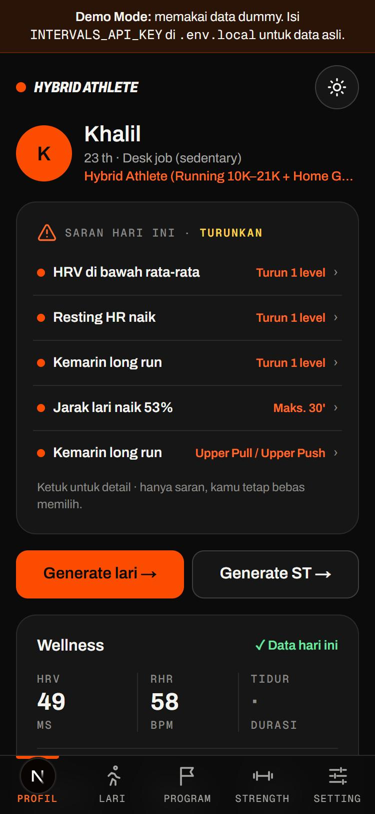
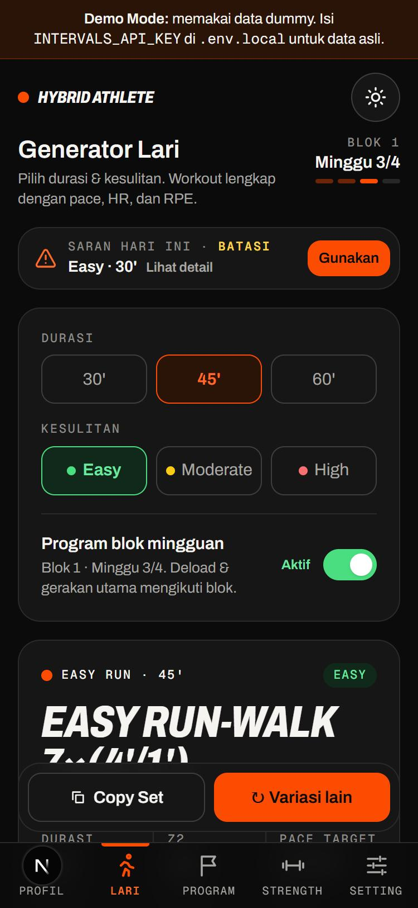
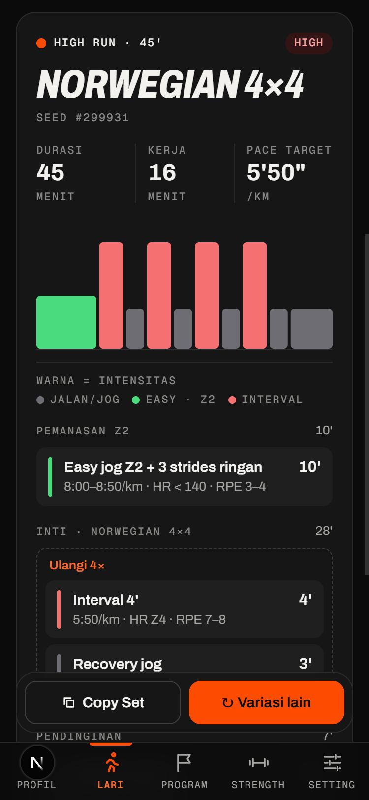
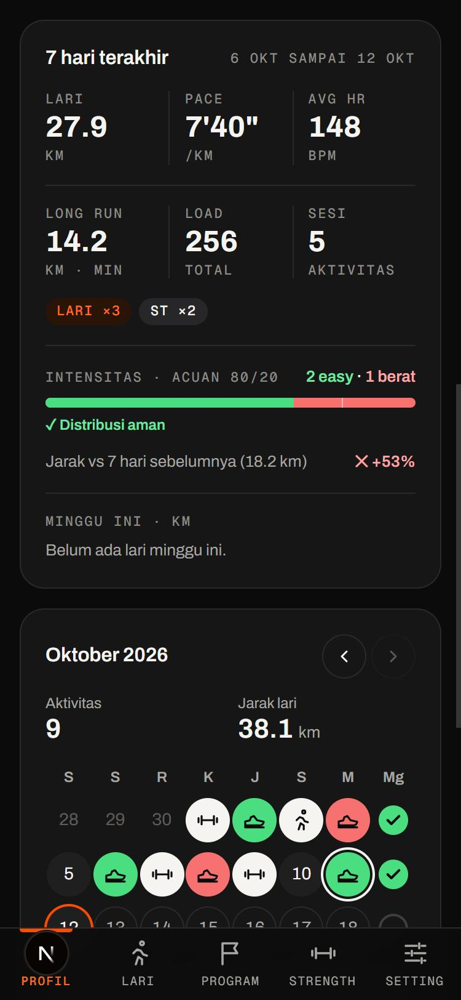
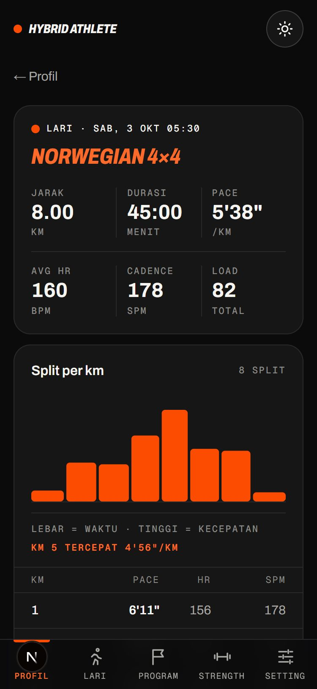
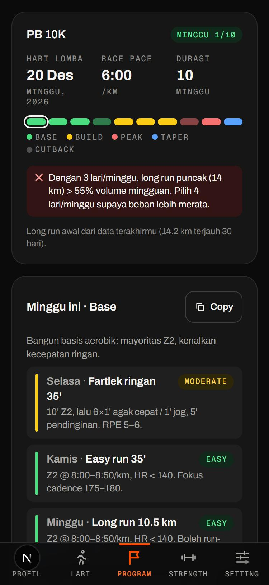
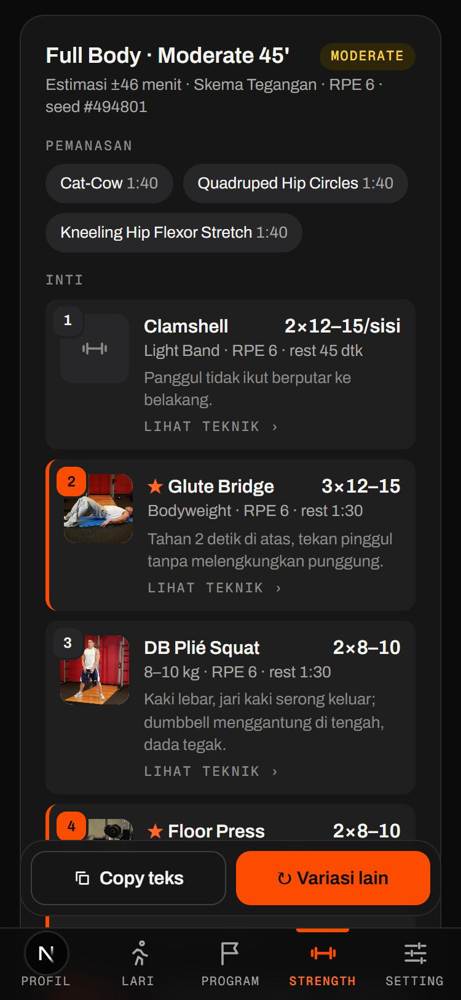
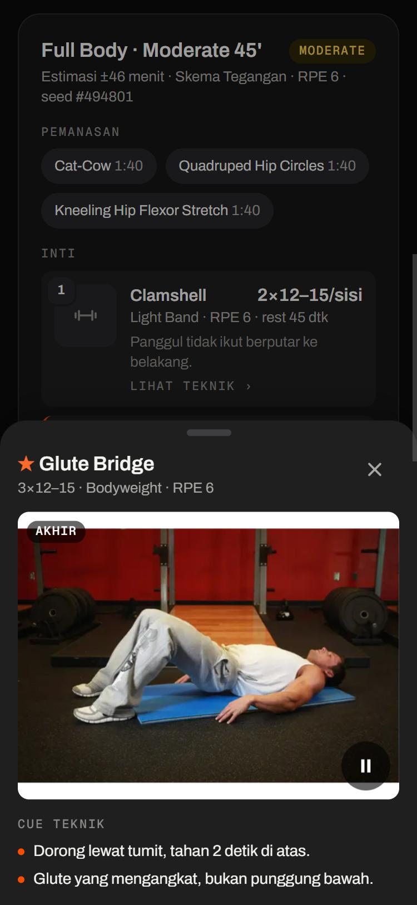
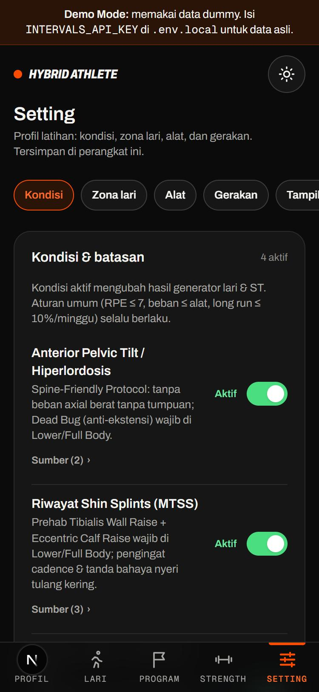
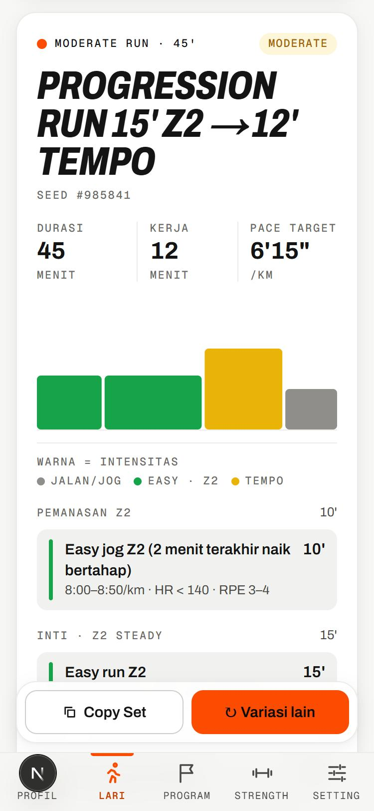

<p align="center">
  <picture>
    <source media="(prefers-color-scheme: dark)" srcset="docs/brand/lockup-on-dark.png">
    
  </picture>
</p>

# Hybrid Athlete Dashboard

Dashboard pelatih pribadi untuk **hybrid athlete** (lari 10K–21K + strength training di rumah). Aplikasi ini membaca data latihan dan wellness dari [intervals.icu](https://intervals.icu), lalu membuat program **lari** dan **strength training (ST)** yang menyesuaikan diri dengan profil, kondisi cedera, dan kesiapan tubuh atlet hari itu.

Dibangun mobile-first sebagai **PWA**: bisa di-install ke layar utama HP dan dipakai seperti aplikasi native. Tampilannya mengikuti design system **"Tag"** ([docs/DESIGN-SYSTEM.md](docs/DESIGN-SYSTEM.md)): rasanya seperti tag lari yang ditempel di layar. Dark-first dengan permukaan charcoal, satu aksen oranye, judul italic condensed, label mono kecil, angka besar rata kolom, dan grafik yang menggambar bentuk latihan.


<table>
  <tr>
    <td></td>
    <td></td>
    <td></td>
  </tr>
  <tr>
    <td align="center"><sub>Profil &amp; saran hari ini</sub></td>
    <td align="center"><sub>Generator lari</sub></td>
    <td align="center"><sub>Workout + Segment Skyline</sub></td>
  </tr>
  <tr>
    <td></td>
    <td></td>
    <td></td>
  </tr>
  <tr>
    <td align="center"><sub>7 hari terakhir + Week Ledger</sub></td>
    <td align="center"><sub>Detail aktivitas + split per km</sub></td>
    <td align="center"><sub>Program target (5K–FM)</sub></td>
  </tr>
  <tr>
    <td></td>
    <td></td>
    <td></td>
  </tr>
  <tr>
    <td align="center"><sub>Generator ST + gambar gerakan</sub></td>
    <td align="center"><sub>Detail teknik gerakan</sub></td>
    <td align="center"><sub>Setting: kondisi, zona, alat</sub></td>
  </tr>
  <tr>
    <td></td>
  </tr>
  <tr>
    <td align="center"><sub>Mode terang</sub></td>
  </tr>
</table>

<sub>Screenshot 0.10.0-ui (Profil & detail aktivitas diperbarui di 0.10.1), diambil dalam Demo Mode (data dummy) di lebar 375px.</sub>

> **Mau memakainya dengan data latihanmu sendiri di HP?** Ikuti [Pasang di HP-mu sendiri](#pasang-di-hp-mu-sendiri): gratis, sekitar 15 menit, tanpa menulis kode.

---

## Kenapa project ini ada

Aplikasi latihan umumnya memberi program generik. Atlet ini punya kebutuhan spesifik yang tidak bisa diabaikan:

- **Anterior pelvic tilt / hiperlordosis:** tidak boleh ada beban axial berat tanpa tumpuan (Spine-Friendly Protocol).
- **Riwayat shin splints:** prehab wajib, dan kenaikan volume lari harus dijaga.
- **Overpronation / crossover gait:** latihan stabilitas panggul, dengan target cadence 175–180 SPM.
- **Home gym terbatas:** dumbbell modular, band, dan pull-up bar. Beban tidak boleh melebihi yang tersedia.

Semua aturan ini dikodekan sebagai **modul TypeScript murni yang diuji**, bukan sekadar teks di prompt. Hasil generator selalu divalidasi sebelum ditampilkan.

Aturannya awalnya dibuat untuk satu atlet, tetapi kondisi, alat, zona lari, dan pilihan gerakan bisa diatur sendiri. Jadi orang lain bisa memasang aplikasi ini dengan profil dan data intervals.icu masing-masing.

## Fitur

| Area | Yang bisa dilakukan |
| --- | --- |
| **Profil** | Data diri, target lomba, saran hari ini, wellness, ringkasan 7 hari, dan kalender aktivitas. |
| **Setting** | Kondisi & batasan dari **katalog berbasis riset** (10 kondisi, masing-masing dengan sumber) yang langsung mengubah generator; zona pace per jenis latihan (manual atau dihitung **VDOT Daniels** dari hasil lomba); alat (dumbbell, plat, barbell, band, pull-up bar); pilihan gerakan movement library; tema; dan cadangan data. |
| **Data intervals.icu** | Ringkasan 7 hari (km, pace, HR, long run, load), kalender aktivitas bulanan (ketuk tanggal untuk detail), detail aktivitas dengan **split per km** (dari data per detik jam atau GPS, divalidasi terhadap ringkasan) dan interval, serta wellness (HRV, resting HR, tidur, CTL/ATL/Form). Aktivitas yang tercatat dobel dari dua sumber (mis. jam + Strava) dihitung sekali. |
| **Generator lari** | 30/45/60 menit × Easy/Moderate/High dengan 13 pola: Z2, run-walk, cadence drill, tempo, cruise interval, progression run, mini interval, Norwegian 4×4, dan 15/15. Target pace dari zona di Setting, cue & catatan dari kondisi aktif, dan durasinya selalu tepat. |
| **Detail gerakan** | Thumbnail di setiap gerakan; tap untuk bottom sheet berisi gambar posisi awal ↔ akhir (crossfade, bisa dijeda), cue teknik, otot utama/sekunder, dan catatan kondisi aktif. Gambar dari free-exercise-db (Unlicense), disimpan lokal. |
| **Generator ST** | Full Body / Upper Push / Upper Pull / Lower. Hanya gerakan yang dipilih & bisa dilakukan dengan alat yang ada, RPE ≤ 7, beban yang benar-benar bisa dirakit dari plat, plus gerakan wajib/terlarang sesuai kondisi aktif (prehab shin, stabilitas panggul, Spine-Friendly, dll.). |
| **Periodisasi** | Blok 4 minggu (3 normal + 1 deload). Gerakan utama ★ dikunci per blok, sedangkan aksesori dan skema rep berputar. Bisa **dimatikan** (toggle) untuk latihan bebas tanpa jadwal blok. |
| **Program target** | Program mingguan menuju **PB 5K, PB 10K, Half Marathon, atau Full Marathon**: fase Base → Build → Peak → Taper, long run naik ≤ 10%/minggu dengan cutback, race pace dari target waktu, dan jadwal ST yang tidak bentrok. |
| **Saran hari ini** | Menggabungkan readiness (HRV, resting HR, sesi kemarin), distribusi 80/20, kenaikan km mingguan, dan jarak antara ST kaki dan lari berat. Sarannya bisa diterapkan dengan satu tap. |
| **Progresi beban** | Catat sesi, lalu beban berikutnya disesuaikan otomatis (aturan "2-for-2" NSCA) ke beban berikutnya yang bisa dirakit, tanpa pernah melewati batas library. Riwayatnya ada di halaman Strength. |
| **Salin cepat** | Workout ST sebagai teks ringkas; workout lari lewat tombol **Copy Set** (format "Set" Huawei Health). |
| **Demo Mode** | Tanpa API key, aplikasi tetap berjalan penuh memakai data dummy. |
| **PWA & design system** | Bisa di-install ke HP dan full-screen. Design system "Tag": dark-first, satu aksen oranye `#FC4C02`, Archivo + Geist Mono, Segment Skyline & Week Ledger, dengan **toggle tema terang/gelap** yang tersimpan di perangkat. |
| **Sistem warna** | Intensitas: **Easy = hijau, Moderate = kuning, High = merah**. Status: **aktif/tercapai = hijau, nonaktif/belum = merah**. Kontras dijaga di tema terang maupun gelap. |

Detail aturan dan dasar ilmiahnya ada di **[docs/TRAINING-LOGIC.md](docs/TRAINING-LOGIC.md)**.

## Pasang di HP-mu sendiri

Gratis, sekitar 15 menit, tanpa menulis kode. Hasilnya: aplikasi di layar utama HP yang membaca data latihanmu sendiri dari intervals.icu, berjalan di akun Vercel milikmu sendiri.

### Yang kamu butuhkan

- Akun **[intervals.icu](https://intervals.icu)** (gratis) yang sudah tersambung **langsung** ke jam atau aplikasi olahragamu (Garmin, Huawei Health, Coros, Polar, Suunto, Wahoo, Zepp, dll.).
  > Strava saja tidak cukup. intervals.icu tidak boleh meneruskan isi aktivitas dari Strava lewat API, jadi aktivitas yang masuk hanya lewat Strava akan tampil kosong ("Aktivitas Strava").
- Akun **[GitHub](https://github.com)** (gratis).
- Akun **[Vercel](https://vercel.com/signup)** paket Hobby (gratis). Paling mudah daftar dengan akun GitHub.
- HP Android dengan Chrome, atau iPhone dengan Safari.

### Langkah 1 · Salin repo ke akun GitHub-mu (fork)

1. Login ke GitHub, buka halaman repo ini, klik **Fork** lalu **Create fork**.
2. Langkah selanjutnya memakai fork milikmu: `github.com/<username-mu>/hybrid-athlete-dashboard`.

### Langkah 2 · Isi profilmu

Di fork-mu, buka [`config/athlete-profile.json`](config/athlete-profile.json), klik ikon pensil (**Edit this file**), ubah isinya, lalu klik **Commit changes**.

| Field | Isi | Bisa diubah lagi di aplikasi? |
| --- | --- | --- |
| `name`, `age`, `occupation`, `category` | Nama dan keterangan di header Profil | Belum, hanya di file ini |
| `targets.goals`, `targets.raceTargets` | Tujuan latihan & target lomba di Profil, juga target default Program | Belum |
| `training.blockStart` | Tanggal **Senin** awal blok latihan 4 minggu (`YYYY-MM-DD`). Isi Senin minggu ini | Belum |
| `conditions` | Kondisi cedera yang aktif: `apt`, `shin`, `overpronation`, `mcu`, `lbp`, `pfp`, `itbs`, `achilles`, `plantar`, `shoulder` (lihat [`lib/conditions.ts`](lib/conditions.ts)). Isi `[]` bila tidak ada | Ya, Setting › Kondisi |
| `equipment` | Alat di rumah: dumbbell (jumlah handle), barbell, plat (`kg` × `count`), band, pull-up bar, kursi | Ya, Setting › Alat |
| `runZones` | Pace default per zona latihan | Ya, Setting › Zona lari (manual atau hitung dari hasil lomba) |
| `movementLibrary` | Gerakan yang boleh dipakai & batas bebannya | Pilihan gerakan ya; batas beban hanya di file |

Fork dari repo publik ikut publik, jadi jangan isi file ini dengan data yang tidak mau dilihat orang lain. Kalau ragu, biarkan nilai bawaannya dan atur sisanya di aplikasi (langkah 7).

### Langkah 3 · Ambil API key intervals.icu

1. Login ke intervals.icu, buka **[Settings](https://intervals.icu/settings)**, lalu gulir ke bagian **Developer Settings** di paling bawah.
2. Buat atau tampilkan **API Key**, lalu salin. Catat juga **Athlete ID** (contoh `i123456`), atau cukup pakai `0` yang berarti pemilik API key.
3. Perlakukan API key seperti kata sandi: jangan ditulis ke file di repo dan jangan dibagikan.

### Langkah 4 · Deploy ke Vercel

1. Buka **[vercel.com/new](https://vercel.com/new)**, pilih fork-mu, klik **Import** (izinkan Vercel membaca repo bila diminta).
2. Ubah **Project Name** bila mau. Nama ini menjadi alamat aplikasimu: `nama-project.vercel.app`.
3. Buka bagian **Environment Variables** dan tambahkan dua variable:

   | Key | Value |
   | --- | --- |
   | `INTERVALS_API_KEY` | API key dari langkah 3 |
   | `INTERVALS_ATHLETE_ID` | Athlete ID-mu, atau `0` |

4. Klik **Deploy** dan tunggu 1 sampai 2 menit, lalu buka alamat yang diberikan. Bila banner **Demo Mode** tidak muncul, data aslimu sudah terbaca.

API key hanya disimpan di Vercel dan dibaca di server. Kunci itu tidak pernah dikirim ke HP atau browser.

### Langkah 5 · Kunci aksesnya (penting)

Aplikasi ini belum punya login. Tanpa langkah ini, siapa pun yang tahu alamatnya bisa melihat data latihan dan kesehatanmu.

1. Di Vercel, buka project-mu, lalu **Settings › Deployment Protection**.
2. Aktifkan **Vercel Authentication** dengan cakupan **All Deployments**. Pilihan ini gratis di paket Hobby. Jangan berhenti di **Standard Protection**, karena cakupan itu tidak melindungi alamat utama `nama-project.vercel.app`.
3. Setelah itu, saat membuka aplikasi kamu diminta login dengan akun Vercel-mu.

Aplikasi yang dipasang di iPhone memakai penyimpanan terpisah dari Safari, jadi mungkin perlu login sekali lagi dari dalam aplikasi. Kombinasi proteksi ini dengan aplikasi yang dipasang belum diuji di semua HP.

### Langkah 6 · Pasang di HP

- **Android (Chrome):** buka alamat Vercel-mu, ketuk menu **⋮**, lalu **Instal aplikasi** atau **Tambahkan ke layar utama**.
- **iPhone (Safari):** buka alamat Vercel-mu, ketuk **Bagikan**, lalu **Tambah ke Layar Utama**.

Aplikasi terbuka layar penuh dengan ikon "Forward H", seperti aplikasi biasa.

### Langkah 7 · Atur di dalam aplikasi

Buka tab **Setting**:

- **Kondisi & batasan:** aktifkan hanya yang benar-benar kamu alami. Setiap kondisi mengubah generator lari dan ST.
- **Zona lari:** isi pace per zona, atau isi hasil lomba/time trial terbaru lalu ketuk **Terapkan ke semua zona** (rumus VDOT Daniels).
- **Alat** dan **Gerakan:** centang yang kamu punya dan mau dipakai.

Pengaturan dan log latihan tersimpan di perangkat itu saja. Untuk pindah atau menambah perangkat: **Setting › Data & cadangan**, ekspor JSON, lalu impor di perangkat baru.

### Memperbarui ke versi terbaru

1. Buka fork-mu di GitHub, klik **Sync fork**, lalu **Update branch**. Vercel otomatis men-deploy ulang.
2. Bila GitHub melaporkan konflik (biasanya di `config/athlete-profile.json`), salin dulu isi file profilmu, pilih **Discard commits** untuk mengikuti versi terbaru, lalu isi lagi profilmu seperti langkah 2.
3. Di HP, tutup lalu buka lagi aplikasinya agar memuat versi baru.

### Kalau ada masalah

| Gejala | Penyebab dan solusinya |
| --- | --- |
| Banner **Demo Mode** masih muncul | Environment variable belum terisi, atau belum di-deploy ulang setelah diisi. Vercel › **Deployments** › **⋯** › **Redeploy**. |
| **API key ditolak (401)** | API key salah ketik atau sudah dibuat ulang. Salin lagi dari intervals.icu, perbarui di Vercel, lalu Redeploy. |
| **Akses ditolak (403)** | Athlete ID tidak cocok dengan pemilik API key. Isi `0`. |
| Aktivitas tampil sebagai **Aktivitas Strava** tanpa data | Aktivitas itu hanya masuk lewat Strava. Sambungkan jam atau aplikasimu langsung ke intervals.icu. |
| **Split per km** tidak muncul | Jam tidak mengirim jarak per detik atau GPS ke intervals.icu, atau datanya tidak cocok dengan ringkasan aktivitas. Ringkasan sesi tetap tampil. |
| Tampilan atau ikon di HP masih versi lama | Tutup lalu buka lagi aplikasinya. Untuk ikon, hapus aplikasi dari layar utama lalu pasang ulang. |

## Progres pengembangan

| Versi | Status | Isi |
| --- | --- | --- |
| **0.1** Fondasi | ✅ Selesai | Profil + integrasi intervals.icu, generator lari & ST, validator aturan WAJIB, Demo Mode, readiness advisory, PWA, deploy Vercel |
| **0.2** Variasi terstruktur | ✅ Selesai | Periodisasi blok 4 minggu + deload, gerakan utama ★ per blok, rotasi skema rep, perpustakaan pola lari, target cadence personal, polesan UI mobile-native |
| **0.3** Konteks mingguan | ✅ Selesai | Aturan 80/20, peringatan kenaikan km > 30%, jarak concurrent training, kartu "Saran hari ini" dengan tombol aksi |
| **0.4** Progresi beban | ✅ Selesai | Log sesi di perangkat, progresi otomatis 2-for-2, halaman Log, ekspor/impor JSON |
| **0.5** Redesign UI | ✅ Selesai | Design system baru: token semantik, oranye sebagai warna utama, kartu ber-shadow, tipografi sistem, kontras teks AA, dark mode dari token yang sama |
| **0.6** Fleksibilitas & program target | ✅ Selesai | Toggle tema terang/gelap, sudut membulat, warna intensitas & status, toggle blok mingguan (mode bebas), modul Program Target 5K/10K/HM/FM |
| **0.7** Profil lebih ringkas | ✅ Selesai | Kalender aktivitas bulanan (ketuk tanggal untuk detail), saran hari ini ringkas dengan dropdown, kondisi & batasan dropdown |
| **0.8** Halaman Setting | ✅ Selesai | Tab Log → Setting: katalog kondisi berbasis riset yang mengubah generator, zona pace (VDOT Daniels), alat & beban yang bisa dirakit, pilihan movement library, cadangan data. Riwayat log pindah ke Strength |
| **0.9** Visual gerakan | ✅ Selesai | Gambar & detail teknik untuk 35/40 gerakan (free-exercise-db), 13 gerakan baru (stabilitas panggul, core, unilateral, soleus, bahu), toggle titik tambat band |
| **0.10-ui** Redesign "Tag" | ✅ Selesai | Token dark-first, tipografi Archivo + Geist Mono, StatRow, Segment Skyline (rencana & selesai), Week Ledger, kontras tombol AA |
| **0.10.1–0.10.2** Logo & data aktivitas | ✅ Selesai | Logo "Forward H", aktivitas ganda Huawei + Strava dihitung sekali, split per km yang divalidasi (GPS bila perlu), pemilih waktu & pace di Setting |
| Berikutnya | 💡 Rencana | Proteksi akses + sinkron data, program terhubung ke generator, grafik tren, mode offline. Lihat [roadmap di PRD](docs/PRD.md#7-roadmap--saran-pengembangan) |

Riwayat lengkap per versi ada di **[CHANGELOG.md](CHANGELOG.md)**.

## Tech stack

- **Next.js 16** (App Router, Server Components) + **React 19** + **TypeScript**
- **Tailwind CSS 4** dengan token semantik di [`app/globals.css`](app/globals.css). Dark mode mengikuti pengaturan sistem.
- **Vitest**: 10 file test, 178 test yang mencakup seluruh kombinasi input generator, program target, efek setiap kondisi/alat di Setting, dan perhitungan split per km dari data jam
- **intervals.icu REST API** (aktivitas, wellness, stream per detik), dipanggil hanya dari server
- Grafik SVG buatan sendiri (Segment Skyline), tanpa library chart
- Tanpa database. Profil default disimpan di JSON; Setting, log sesi, dan program di localStorage perangkat (bisa diekspor/impor).
- Deploy di **Vercel**

Arsitektur dan alur data dijelaskan di **[docs/ARCHITECTURE.md](docs/ARCHITECTURE.md)**.

## Menjalankan di komputer (untuk developer)

Butuh Node.js 20.9 atau lebih baru.

```bash
git clone https://github.com/khaliladha11/hybrid-athlete-dashboard.git
cd hybrid-athlete-dashboard
npm install
npm run dev
```

Buka http://localhost:3000. Tanpa konfigurasi apa pun, aplikasi berjalan di **Demo Mode** dengan data dummy.

Untuk memakai data asli, salin `.env.example` menjadi `.env.local` (sudah masuk `.gitignore`), lalu restart `npm run dev`:

```env
INTERVALS_API_KEY=isi_api_key_kamu
INTERVALS_ATHLETE_ID=0   # 0 = pemilik API key, atau ID seperti i123456
```

API key hanya dibaca di server (`import "server-only"`) dan tidak pernah dikirim ke browser. Error 401/403/404/5xx ditampilkan sebagai pesan singkat tanpa stack trace. Cara deploy sama dengan [langkah 4](#langkah-4--deploy-ke-vercel); setiap `git push` ke `main` men-deploy ulang otomatis.

### Perintah

| Perintah | Fungsi |
| --- | --- |
| `npm run dev` | Server development |
| `npm test` | Semua unit test (Vitest) |
| `npm run typecheck` | Pemeriksaan TypeScript |
| `npm run build` | Build produksi |
| `npm run icons` | Render ulang ikon PWA & favicon dari `public/icon.svg` dan `public/favicon.svg` |

## Struktur project

```
app/                     halaman: Profil, /run, /program, /strength, /setting, /activity/[id]
components/              UI: profile/, generator/, program/, settings/, log/, movements/, charts/, ui/
config/athlete-profile.json
lib/
  generator/             modul murni: run, strength, block (periodisasi), validate, format, rng
  intervals/             client (server-only), normalize, summary, data-source, dedupe, splits
  coach.ts               saran mingguan (80/20, progresi km, concurrent)
  conditions.ts          katalog kondisi berbasis riset → aturan generator
  run-zones.ts           rumus VDOT Daniels & pace
  equipment.ts           kebutuhan alat per gerakan, beban yang bisa dirakit
  athlete-settings.ts    pengaturan Setting → profil efektif
  movements/media.ts     gambar, cue, otot & sumber per gerakan
  program.ts             program target 5K / 10K / HM / FM
  preferences.ts         tema & toggle blok (localStorage)
  progression.ts         aturan progresi beban 2-for-2
  training-log.ts        penyimpanan log di perangkat
  readiness.ts           sinyal kesiapan dari wellness
  mock-data.ts           data Demo Mode
public/                  manifest PWA, ikon, favicon & gambar gerakan (movements/)
__tests__/               unit test Vitest
docs/                    PRD, dokumentasi, screenshot & aset logo (brand/)
```

## Dokumentasi

Tampilan mengikuti **[docs/DESIGN-SYSTEM.md](docs/DESIGN-SYSTEM.md)** (design system "Tag"), logo di **[docs/brand/LOGO.md](docs/brand/LOGO.md)**.

- **[docs/PRD.md](docs/PRD.md)**: gambaran produk, status semua fitur (sudah/belum), keterbatasan, dan roadmap pengembangan.
- **[docs/TRAINING-LOGIC.md](docs/TRAINING-LOGIC.md)**: semua aturan generator, periodisasi, saran, progresi beban, dan referensi ilmiahnya.
- **[docs/ARCHITECTURE.md](docs/ARCHITECTURE.md)**: arsitektur, alur data, batas keamanan, dan strategi testing.
- **[CHANGELOG.md](CHANGELOG.md)**: riwayat perubahan per versi.
- **[NOTICE.md](NOTICE.md)**: atribusi gambar gerakan (free-exercise-db, Unlicense).

## Disclaimer

Aplikasi ini adalah alat bantu perencanaan latihan pribadi, **bukan pengganti saran dokter, fisioterapis, atau pelatih bersertifikat**. Aturan di dalamnya awalnya dirancang untuk satu profil atlet tertentu. Bila kamu memasangnya untuk dirimu sendiri, sesuaikan kondisi, alat, dan zona dengan keadaanmu, konsultasikan cedera dengan tenaga kesehatan, dan hentikan latihan bila muncul nyeri.
