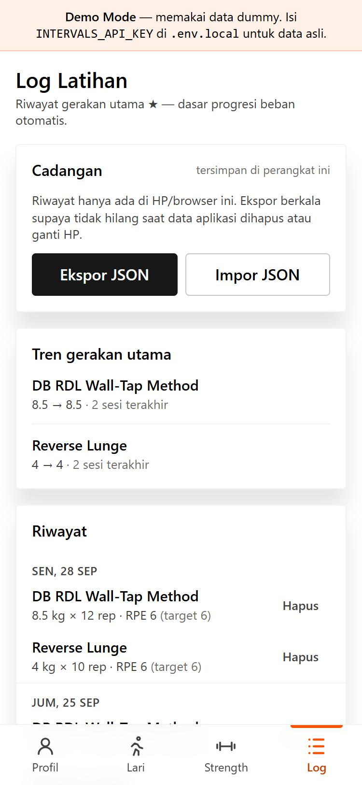
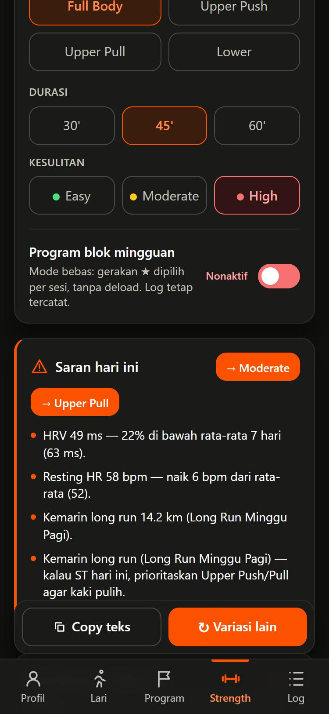

# Hybrid Athlete Dashboard

Dashboard pelatih pribadi untuk **hybrid athlete** (lari 10K–21K + strength training di rumah). Aplikasi ini membaca data latihan dan wellness dari [intervals.icu](https://intervals.icu), lalu membuat program **lari** dan **strength training (ST)** yang menyesuaikan diri dengan profil, kondisi cedera, dan kesiapan tubuh atlet hari itu.

Dibangun mobile-first sebagai **PWA**: bisa di-install ke layar utama HP dan dipakai seperti aplikasi native. Tampilannya mengikuti design system bergaya aplikasi olahraga: putih bersih, oranye energik, dan kontras tinggi supaya tetap terbaca di bawah matahari.


<table>
  <tr>
    <td></td>
    <td></td>
    <td></td>
  </tr>
  <tr>
    <td align="center"><sub>Profil &amp; saran hari ini</sub></td>
    <td align="center"><sub>Generator lari: kesulitan berwarna &amp; toggle blok</sub></td>
    <td align="center"><sub>Workout lari (hijau/kuning/merah)</sub></td>
  </tr>
  <tr>
    <td></td>
    <td></td>
    <td></td>
  </tr>
  <tr>
    <td align="center"><sub>Program target (5K–FM)</sub></td>
    <td align="center"><sub>Generator ST + progresi beban</sub></td>
    <td align="center"><sub>Riwayat latihan (✓/✕ target)</sub></td>
  </tr>
  <tr>
    <td></td>
    <td></td>
  </tr>
  <tr>
    <td align="center"><sub>Ringkasan 7 hari (80/20, tren km)</sub></td>
    <td align="center"><sub>Dark mode + mode bebas</sub></td>
  </tr>
</table>

<sub>Screenshot diambil dalam Demo Mode (data dummy).</sub>

---

## Kenapa project ini ada

Aplikasi latihan umumnya memberi program generik. Atlet ini punya kebutuhan spesifik yang tidak bisa diabaikan:

- **Anterior pelvic tilt / hiperlordosis:** tidak boleh ada beban axial berat tanpa tumpuan (Spine-Friendly Protocol).
- **Riwayat shin splints:** prehab wajib, dan kenaikan volume lari harus dijaga.
- **Overpronation / crossover gait:** latihan stabilitas panggul, dengan target cadence 175–180 SPM.
- **Home gym terbatas:** dumbbell modular, band, dan pull-up bar. Beban tidak boleh melebihi yang tersedia.

Semua aturan ini dikodekan sebagai **modul TypeScript murni yang diuji**, bukan sekadar teks di prompt. Hasil generator selalu divalidasi sebelum ditampilkan.

## Fitur

| Area | Yang bisa dilakukan |
| --- | --- |
| **Profil** | Data diri, target lomba, saran hari ini, wellness, ringkasan 7 hari, dan kalender aktivitas. |
| **Setting** | Kondisi & batasan dari **katalog berbasis riset** (10 kondisi, masing-masing dengan sumber) yang langsung mengubah generator; zona pace per jenis latihan (manual atau dihitung **VDOT Daniels** dari hasil lomba); alat (dumbbell, plat, barbell, band, pull-up bar); pilihan gerakan movement library; tema; dan cadangan data. |
| **Data intervals.icu** | Ringkasan 7 hari (km, pace, HR, long run, load), kalender aktivitas bulanan (ketuk tanggal untuk detail), detail interval per aktivitas, serta wellness (HRV, resting HR, tidur, CTL/ATL/Form). |
| **Generator lari** | 30/45/60 menit × Easy/Moderate/High dengan 13 pola: Z2, run-walk, cadence drill, tempo, cruise interval, progression run, mini interval, Norwegian 4×4, dan 15/15. Target pace dari zona di Setting, cue & catatan dari kondisi aktif, dan durasinya selalu tepat. |
| **Detail gerakan** | Thumbnail di setiap gerakan; tap untuk bottom sheet berisi gambar posisi awal ↔ akhir (crossfade, bisa dijeda), cue teknik, otot utama/sekunder, dan catatan kondisi aktif. Gambar dari free-exercise-db (Unlicense), disimpan lokal. |
| **Generator ST** | Full Body / Upper Push / Upper Pull / Lower. Hanya gerakan yang dipilih & bisa dilakukan dengan alat yang ada, RPE ≤ 7, beban yang benar-benar bisa dirakit dari plat, plus gerakan wajib/terlarang sesuai kondisi aktif (prehab shin, stabilitas panggul, Spine-Friendly, dll.). |
| **Periodisasi** | Blok 4 minggu (3 normal + 1 deload). Gerakan utama ★ dikunci per blok, sedangkan aksesori dan skema rep berputar. Bisa **dimatikan** (toggle) untuk latihan bebas tanpa jadwal blok. |
| **Program target** | Program mingguan menuju **PB 5K, PB 10K, Half Marathon, atau Full Marathon**: fase Base → Build → Peak → Taper, long run naik ≤ 10%/minggu dengan cutback, race pace dari target waktu, dan jadwal ST yang tidak bentrok. |
| **Saran hari ini** | Menggabungkan readiness (HRV, resting HR, sesi kemarin), distribusi 80/20, kenaikan km mingguan, dan jarak antara ST kaki dan lari berat. Sarannya bisa diterapkan dengan satu tap. |
| **Progresi beban** | Catat sesi, lalu beban berikutnya disesuaikan otomatis (aturan "2-for-2" NSCA) ke beban berikutnya yang bisa dirakit, tanpa pernah melewati batas library. Riwayatnya ada di halaman Strength. |
| **Salin cepat** | Workout ST sebagai teks ringkas; workout lari lewat tombol **Copy Set** (format "Set" Huawei Health). |
| **Demo Mode** | Tanpa API key, aplikasi tetap berjalan penuh memakai data dummy. |
| **PWA & design system** | Bisa di-install ke HP dan full-screen. Design system "Tag": dark-first, satu aksen oranye `#FC4C02`, Archivo + Geist Mono, Segment Skyline & Week Ledger, dengan **toggle tema terang/gelap** yang tersimpan di perangkat. |
| **Sistem warna** | Intensitas: **Easy = hijau, Moderate = kuning, High = merah**. Status: **aktif/tercapai = hijau, nonaktif/belum = merah**. Kontras dijaga di tema terang maupun gelap. |

Detail aturan dan dasar ilmiahnya ada di **[docs/TRAINING-LOGIC.md](docs/TRAINING-LOGIC.md)**.

## Progres pengembangan

| Versi | Status | Isi |
| --- | --- | --- |
| **0.1** Fondasi | ✅ Selesai | Profil + integrasi intervals.icu, generator lari & ST, validator aturan WAJIB, Demo Mode, readiness advisory, PWA, deploy Vercel |
| **0.2** Variasi terstruktur | ✅ Selesai | Periodisasi blok 4 minggu + deload, gerakan utama ★ per blok, rotasi skema rep, perpustakaan pola lari, target cadence personal, polesan UI mobile-native |
| **0.3** Konteks mingguan | ✅ Selesai | Aturan 80/20, peringatan kenaikan km > 30%, jarak concurrent training, kartu "Saran hari ini" dengan tombol aksi |
| **0.4** Progresi beban | ✅ Selesai | Log sesi di perangkat, progresi otomatis 2-for-2, halaman Log, ekspor/impor JSON |
| **0.5** Redesign UI | ✅ Selesai | Design system baru: token semantik, oranye sebagai warna utama, kartu ber-shadow, tipografi sistem, kontras teks AA, dark mode dari token yang sama |
| **0.6** Fleksibilitas & program target | ✅ Selesai | Toggle tema terang/gelap, sudut membulat, warna intensitas & status, toggle blok mingguan (mode bebas), modul Program Target 5K/10K/HM/FM |
| **0.7** Profil lebih ringkas | ✅ Selesai | Kalender aktivitas bulanan (ketuk tanggal untuk detail), saran hari ini ringkas dengan dropdown, kondisi & batasan dropdown |
| **0.8** Halaman Setting | ✅ Selesai | Tab Log → Setting: katalog kondisi berbasis riset yang mengubah generator, zona pace (VDOT Daniels), alat & beban yang bisa dirakit, pilihan movement library, cadangan data. Riwayat log pindah ke Strength |
| **0.9** Visual gerakan | ✅ Selesai | Gambar & detail teknik untuk 35/40 gerakan (free-exercise-db), 13 gerakan baru (stabilitas panggul, core, unilateral, soleus, bahu), toggle titik tambat band |
| **0.10-ui** Redesign "Tag" | ✅ Selesai | Token dark-first, tipografi Archivo + Geist Mono, StatRow, Segment Skyline (rencana & selesai), Week Ledger, kontras tombol AA |
| Berikutnya | 💡 Rencana | Proteksi akses + sinkron data, program terhubung ke generator, grafik tren, mode offline. Lihat [roadmap di PRD](docs/PRD.md#7-roadmap--saran-pengembangan) |

Riwayat lengkap per versi ada di **[CHANGELOG.md](CHANGELOG.md)**.

## Tech stack

- **Next.js 16** (App Router, Server Components) + **React 19** + **TypeScript**
- **Tailwind CSS 4** dengan token semantik di [`app/globals.css`](app/globals.css). Dark mode mengikuti pengaturan sistem.
- **Vitest**: 8 file test, 130+ test yang mencakup seluruh kombinasi input generator, program target, dan efek setiap kondisi/alat di Setting
- **intervals.icu REST API**, dipanggil hanya dari server
- Tanpa database. Profil default disimpan di JSON; Setting, log sesi, dan program di localStorage perangkat (bisa diekspor/impor).
- Deploy di **Vercel**

Arsitektur dan alur data dijelaskan di **[docs/ARCHITECTURE.md](docs/ARCHITECTURE.md)**.

## Mulai cepat

Butuh Node.js 20.9 atau lebih baru.

```bash
git clone https://github.com/khaliladha11/hybrid-athlete-dashboard.git
cd hybrid-athlete-dashboard
npm install
npm run dev
```

Buka http://localhost:3000. Tanpa konfigurasi apa pun, aplikasi berjalan di **Demo Mode**.

### Hubungkan ke intervals.icu

1. Login ke https://intervals.icu, lalu buka **Settings → Developer Settings → Generate API Key**.
2. Salin `.env.example` menjadi `.env.local` dan isi:

   ```env
   INTERVALS_API_KEY=isi_api_key_kamu
   INTERVALS_ATHLETE_ID=0   # 0 = pemilik API key, atau ID seperti i123456
   ```

3. Restart `npm run dev`.

API key hanya dibaca di server (`import "server-only"`) dan tidak pernah dikirim ke browser. Error 401/403/404/5xx ditampilkan sebagai pesan singkat tanpa stack trace.

### Sesuaikan dengan atlet lain

Kondisi, zona lari, alat, dan pilihan gerakan bisa diubah langsung di halaman **Setting** (tersimpan di perangkat). Nilai default-nya ada di [`config/athlete-profile.json`](config/athlete-profile.json):

- **`movementLibrary`**: whitelist gerakan dan batas beban (`"10–20 kg/tangan"`, `"Bodyweight"`, `"Light/Medium Band"`). Gerakan dengan `"available": false` belum dipilih secara default (bisa dicentang di Setting).
- **`conditions`**: id kondisi aktif dari katalog [`lib/conditions.ts`](lib/conditions.ts), mis. `["apt", "shin", "overpronation", "mcu"]`.
- **`equipment`**: dumbbell (berat handle, jumlah), barbell (berat batang), plat (`kg` × `count`), band, pull-up bar, kursi/bench.
- **`runZones`**: pace default per zona.
- **`training.blockStart`**: tanggal Senin awal blok periodisasi. Ubah tanggal ini untuk memulai blok baru.
- **`targets`**: ditampilkan di profil dan dipakai sebagai target default Program.

## Perintah

| Perintah | Fungsi |
| --- | --- |
| `npm run dev` | Server development |
| `npm test` | Semua unit test (Vitest) |
| `npm run typecheck` | Pemeriksaan TypeScript |
| `npm run build` | Build produksi |
| `npm run icons` | Render ulang ikon PWA dari `public/icon.svg` |

## Deploy ke Vercel

1. Import repo ini di https://vercel.com/new (preset Next.js terdeteksi otomatis).
2. Tambahkan environment variable `INTERVALS_API_KEY` dan `INTERVALS_ATHLETE_ID`.
3. Klik **Deploy**. Setiap `git push` ke `main` akan men-deploy ulang otomatis.

Kalau environment variable diubah setelah deploy, buka **Deployments → ⋯ → Redeploy**.

> **Privasi:** aplikasi belum punya login, jadi siapa pun yang tahu URL-nya bisa melihat data intervals.icu pemiliknya. Simpan URL secara privat, atau aktifkan **Settings → Deployment Protection → Vercel Authentication**.

## Install di HP

- **Android (Chrome):** buka URL Vercel → menu **⋮** → **Install aplikasi / Tambahkan ke Layar Utama**.
- **iPhone (Safari):** buka URL Vercel → tombol **Share** → **Tambah ke Layar Utama**.

Install PWA butuh HTTPS, jadi URL Vercel bisa langsung dipakai. Setelah ada deploy baru, tutup lalu buka lagi aplikasinya untuk memuat versi terbaru.

## Struktur project

```
app/                     halaman: Profil, /run, /program, /strength, /setting, /activity/[id]
components/              UI: profile/, generator/, program/, settings/, log/, ui/
config/athlete-profile.json
lib/
  generator/             modul murni: run, strength, block (periodisasi), validate, format, rng
  intervals/             client (server-only), normalize, summary, data-source
  coach.ts               saran mingguan (80/20, progresi km, concurrent)
  conditions.ts          katalog kondisi berbasis riset → aturan generator
  run-zones.ts           rumus VDOT Daniels & pace
  equipment.ts           kebutuhan alat per gerakan, beban yang bisa dirakit
  athlete-settings.ts    pengaturan Setting → profil efektif
  movements/media.ts     gambar, cue, otot & sumber per gerakan
  program.ts             program target 5K / 10K / HM / FM
  preferences.ts         tema & toggle blok (localStorage)
  progression.ts         aturan progresi beban 2-for-2
  training-log.ts        penyimpanan log di perangkat
  readiness.ts           sinyal kesiapan dari wellness
  mock-data.ts           data Demo Mode
public/                  manifest PWA, ikon & gambar gerakan (movements/)
__tests__/               unit test Vitest
docs/                    PRD, dokumentasi & screenshot
```

## Dokumentasi

Tampilan mengikuti **[docs/DESIGN-SYSTEM.md](docs/DESIGN-SYSTEM.md)** (design system "Tag").

- **[docs/PRD.md](docs/PRD.md)**: gambaran produk, status semua fitur (sudah/belum), keterbatasan, dan roadmap pengembangan.
- **[docs/TRAINING-LOGIC.md](docs/TRAINING-LOGIC.md)**: semua aturan generator, periodisasi, saran, progresi beban, dan referensi ilmiahnya.
- **[docs/ARCHITECTURE.md](docs/ARCHITECTURE.md)**: arsitektur, alur data, batas keamanan, dan strategi testing.
- **[CHANGELOG.md](CHANGELOG.md)**: riwayat perubahan per versi.
- **[NOTICE.md](NOTICE.md)**: atribusi gambar gerakan (free-exercise-db, Unlicense).

## Disclaimer

Aplikasi ini adalah alat bantu perencanaan latihan pribadi, **bukan pengganti saran dokter, fisioterapis, atau pelatih bersertifikat**. Aturan di dalamnya dirancang untuk satu profil atlet tertentu. Sesuaikan dengan kondisimu sendiri, dan hentikan latihan bila muncul nyeri.
