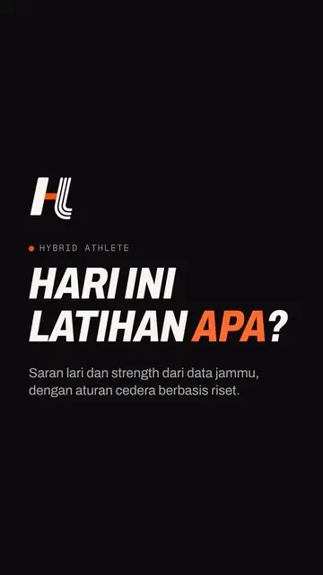

<p align="center">
  <picture>
    <source media="(prefers-color-scheme: dark)" srcset="docs/brand/lockup-on-dark.png">
    
  </picture>
</p>

<p align="center"><b>Saran latihan harian lari + strength dari data jammu, dengan aturan cedera yang berbasis riset.</b></p>

<p align="center">
  <a href="https://github.com/khaliladha11/hybrid-athlete-dashboard/actions/workflows/ci.yml"></a>
  <a href="CHANGELOG.md"></a>
  <a href="LICENSE"></a>
</p>

<!-- Pratinjau dibuat ulang dengan `npm run media:video` (marketing/README.md). -->
<p align="center">
  
</p>

<p align="center"><sub>Direkam dari Demo Mode (data fiktif). Galeri lengkap di <a href="docs/GUIDE.md#galeri-screenshot">Panduan</a>.</sub></p>

## Kenapa app ini

Data latihan dari jam sudah lengkap, tetapi tidak memberi tahu **hari ini harus latihan apa dan seberapa berat**.
Program generik juga tidak tahu riwayat cedera, alat di rumah, dan kelelahanmu.
Aplikasi ini membaca data [intervals.icu](https://intervals.icu)-mu, lalu menyusun lari dan strength yang aman untukmu. Keputusan akhir tetap di kamu.

## Fitur

- **Lari:** generator 30/45/60 menit × Easy/Moderate/High dengan 13 pola (Z2, tempo, progression, Norwegian 4×4, 15/15, …), pace dari zona VDOT-mu, dan split per km di detail aktivitas.
- **Strength:** hanya gerakan yang kamu pilih dan bisa dirakit dari alatmu, RPE ≤ 7, progresi beban otomatis, mode latihan dengan timer, dan peta otot.
- **Program:** menuju 5K, 10K, HM, atau FM dari Hari H yang kamu pilih; mingguan dan fleksibel, kepatuhan otomatis, perkiraan waktu lomba.
- **Insight & saran:** saran harian dari Gita (resting HR, HRV, check-in, 80/20, kenaikan km), tren CTL/ATL, km mingguan, PR, dan heatmap otot.
- **Kirim ke jam:** workout lari terstruktur ke kalender intervals.icu, lalu ke Huawei, Garmin, atau Coros. Copy Set tetap ada sebagai cadangan.

Juga: PWA yang terbuka tanpa sinyal, sinkron antar perangkat (opsional), Demo Mode tanpa API key. Rincian lengkap ada di [Panduan › Fitur lengkap](docs/GUIDE.md#fitur-lengkap).

## Berbasis riset

Aturan latihan ditulis sebagai kode yang diuji, bukan prompt AI. Katalog 10 kondisi cedera (shin splints, nyeri lutut depan, punggung bawah, Achilles, dan lainnya), batas beban, taper, dan ambang kesiapan masing-masing bersandar pada pedoman klinis, meta-analisis, dan buku teks. Semua sumber, beserta label tingkat buktinya, ada di **[docs/REFERENCES.md](docs/REFERENCES.md)**; aturannya di [docs/TRAINING-LOGIC.md](docs/TRAINING-LOGIC.md).

## Mulai cepat

**Yang dibutuhkan:** akun [intervals.icu](https://intervals.icu) yang tersambung langsung ke jammu (Strava saja tidak cukup), akun GitHub dan [Vercel](https://vercel.com/signup) Hobby (gratis), dan HP Android/iPhone. [Upstash Redis](#upstash-redis) opsional untuk sinkron.

1. **Tombol Deploy** (paling mudah). Siapkan dulu tiga nilai di [Variabel lingkungan](#variabel-lingkungan), lalu klik:

   [](https://vercel.com/new/clone?repository-url=https%3A%2F%2Fgithub.com%2Fkhaliladha11%2Fhybrid-athlete-dashboard&project-name=hybrid-athlete&repository-name=hybrid-athlete&env=INTERVALS_API_KEY%2CAPP_PASSCODE%2CSESSION_SECRET&envDescription=API+key+intervals.icu%2C+sandi+aplikasi%2C+dan+teks+acak+untuk+sesi.+Cara+mendapatkannya+ada+di+README.&envLink=https%3A%2F%2Fgithub.com%2Fkhaliladha11%2Fhybrid-athlete-dashboard%23variabel-lingkungan)

2. **Dipandu asisten AI:** tempel prompt di **[INSTALL-WITH-AI.md](INSTALL-WITH-AI.md)**. Rahasia tetap kamu ketik sendiri di Vercel, tidak pernah di chat.
3. **Vercel CLI atau fork manual:** lihat [Panduan › Memasang](docs/GUIDE.md#memasang).

Setelah deploy: masukkan sandi aplikasi, ikuti onboarding, [kunci aksesnya](#setelah-deploy-kunci-aksesnya), lalu pasang ke layar utama HP. Langkah lengkap dan pemecahan masalah ada di [Panduan](docs/GUIDE.md#memasang).

### Variabel lingkungan

Isi di **Vercel › project-mu › Settings › Environment Variables** (atau di `.env.local` saat menjalankan di komputer). Daftar ini berasal dari [`lib/env-schema.ts`](lib/env-schema.ts) dan dijaga test.

| Nama | Wajib di tombol | Untuk apa | Dari mana |
| --- | --- | --- | --- |
| `INTERVALS_API_KEY` | Ya | API key intervals.icu: membaca aktivitas & wellness dan mengirim workout ke kalender. Kosong = Demo Mode | [intervals.icu › Settings](https://intervals.icu/settings) › **Developer Settings** (paling bawah) › **API Key** |
| `APP_PASSCODE` | Ya | Sandi aplikasi, minimal 8 karakter. Mengunci semua halaman dan API | Buat sendiri. Jangan pakai ulang sandi akun lain |
| `SESSION_SECRET` | Ya | Teks acak minimal 32 karakter untuk menandatangani sesi sandi | Lihat [Membuat SESSION_SECRET](#membuat-session_secret) |
| `INTERVALS_ATHLETE_ID` | Tidak | ID atlet intervals.icu. Kosong atau `0` = pemilik API key | intervals.icu › Settings, di bawah nama (diawali `i`). Biasanya tidak perlu |
| `UPSTASH_REDIS_REST_URL`, `UPSTASH_REDIS_REST_TOKEN` | Tidak | Database sinkron antar perangkat. Nama `KV_REST_API_URL` / `KV_REST_API_TOKEN` juga diterima | Diisi otomatis saat [Upstash Redis](#upstash-redis) dihubungkan |

- Perlakukan semua nilai di atas seperti kata sandi: jangan ditulis ke file di repo, jangan ditempel ke chat (termasuk asisten AI).
- **Setiap kali mengubah env, redeploy:** Vercel › **Deployments** › **⋯** › **Redeploy**. Perubahan baru berlaku setelah itu.
- API key, sandi, dan secret hanya dibaca di server. Tidak pernah dikirim ke HP atau browser.

#### Membuat SESSION_SECRET

Jalankan salah satu di terminal, lalu salin hasilnya sendiri ke Vercel. Nilainya tidak disimpan di mana pun.

```bash
npm run secret
```

```bash
openssl rand -base64 32
```

Tanpa clone repo: `node -e "console.log(require('crypto').randomBytes(32).toString('base64url'))"`. Jangan pakai ulang secret dari tempat lain.

### Upstash Redis

Opsional: database di akun Vercel-mu sendiri supaya data sama di HP dan laptop serta ada cadangan otomatis harian. Butuh sandi aplikasi. Di Vercel › project-mu › **Storage** › **Upstash Redis** › **Create** lalu **Connect** (paket Free cukup), lalu **Redeploy**. Detail dan batas paket gratis: [Panduan › Upstash Redis](docs/GUIDE.md#upstash-redis).

### Setelah deploy: kunci aksesnya

Sandi aplikasi sudah mengunci aplikasinya. Tambahkan lapisan di luarnya: Vercel › project-mu › **Settings › Deployment Protection** › aktifkan **Vercel Authentication** dengan cakupan **All Deployments** (gratis). **Standard Protection** tidak melindungi alamat utama. Detail: [Panduan › kunci akses](docs/GUIDE.md#setelah-deploy-kunci-aksesnya).

### Menerima pembaruan

Salinan dan fork menerima setiap rilis lewat **pull request** dari workflow [`upstream-update.yml`](.github/workflows/upstream-update.yml), tidak pernah di-merge otomatis. Sekali saja: centang **Settings › Actions › General › Allow GitHub Actions to create and approve pull requests**. Cara kerja, token opsional, dan konflik: [Panduan › Menerima pembaruan](docs/GUIDE.md#menerima-pembaruan).

## Privasi

- **Satu deploy untuk satu orang.** Aplikasi berjalan di akun Vercel-mu; tidak ada akun, server bersama, atau analitik.
- **Datamu tetap padamu.** Log dan setting ada di HP-mu, dan (bila diaktifkan) di database Upstash di akunmu sendiri. Pemilik repo tidak menerima data siapa pun.
- **Rahasia hanya di server.** API key intervals.icu, sandi, dan token database tidak pernah dikirim ke browser atau ditulis di log.

## Disclaimer

Aplikasi ini alat bantu perencanaan latihan pribadi, **bukan pengganti saran dokter, fisioterapis, atau pelatih bersertifikat**. Aturannya awalnya dirancang untuk satu atlet. Bila kamu memasangnya, sesuaikan kondisi, alat, dan zona dengan keadaanmu, konsultasikan cedera dengan tenaga kesehatan, dan hentikan latihan bila muncul nyeri. Semua saran perlu kamu tinjau sendiri; risikonya ditanggung masing-masing. Saya bukan dokter, hanya atlet rekreasional yang suka mengulik teknologi, sains, dan kesehatan. Terima kasih, dan boleh dong bintangnya.

## Dokumentasi

| Dokumen | Isi |
| --- | --- |
| [Panduan](docs/GUIDE.md) | Memakai aplikasi, memasang, memperbarui, pemecahan masalah, galeri |
| [Keterbatasan](docs/LIMITATIONS.md) | Yang belum bisa dilakukan aplikasi dan jalan keluarnya |
| [Dasar ilmiah](docs/REFERENCES.md) | Semua sumber dengan label tingkat bukti |
| [Logika latihan](docs/TRAINING-LOGIC.md) | Semua aturan generator, saran, program, dan progresi |
| [PRD](docs/PRD.md) | Status fitur, keterbatasan teknis, roadmap |
| [Arsitektur](docs/ARCHITECTURE.md) | Modul, alur data, keamanan, strategi test |
| [Design system](docs/DESIGN-SYSTEM.md) | Design system "Tag" dan [logo](docs/brand/LOGO.md) |
| [Sinkron](docs/SYNC.md) | Sinkron, offline, migrasi, pemulihan data |
| [CHANGELOG](CHANGELOG.md) | Riwayat perubahan per versi |
| [INSTALL-WITH-AI](INSTALL-WITH-AI.md) · [AGENTS](AGENTS.md) | Panduan untuk asisten AI dan alat pemrograman AI |

**Roadmap:** versi sekarang 1.0.0 (stabil, feature freeze). Rencana setelah 1.0 ada di [PRD §7](docs/PRD.md#setelah-10).

## Untuk developer

```bash
npm install
npm run dev
```

Tanpa konfigurasi, aplikasi berjalan di Demo Mode (data fiktif). Perintah test, struktur project, dan cara memakai data asli ada di [Panduan › Untuk developer](docs/GUIDE.md#untuk-developer) dan [CONTRIBUTING.md](CONTRIBUTING.md).

## Kontribusi

Ide dan pertanyaan di [GitHub Discussions](https://github.com/khaliladha11/hybrid-athlete-dashboard/discussions); bug dan masukan logika latihan (wajib dengan sumber) lewat templat issue. Baca [CONTRIBUTING.md](CONTRIBUTING.md) dan [CODE_OF_CONDUCT.md](CODE_OF_CONDUCT.md). Kerentanan dilaporkan secara privat ([SECURITY.md](SECURITY.md)).

## Lisensi & kredit

Kode dirilis di bawah [MIT License](LICENSE), Copyright (c) 2026 Muhammad Khalil Adha. Aset pihak ketiga memakai lisensinya sendiri ([NOTICE.md](NOTICE.md)). Terima kasih untuk semua data, alat, dan inspirasi di [docs/CREDITS.md](docs/CREDITS.md).
