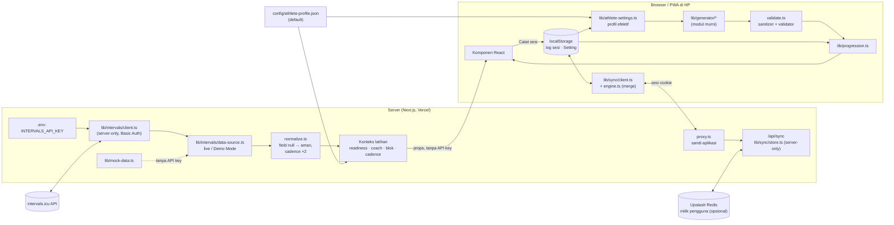

# Arsitektur

## Gambaran besar



## Prinsip desain

**1. API key tidak pernah sampai ke browser.** Semua panggilan intervals.icu ada di [`lib/intervals/client.ts`](../lib/intervals/client.ts), yang memakai `import "server-only"`, sehingga build akan gagal jika file ini diimpor dari komponen client. Halaman adalah Server Component yang mengambil data lalu mengirim hasil olahan (bukan key) sebagai props.

**2. Generator adalah fungsi murni.** `generateRunWorkout` dan `generateStrengthWorkout` menerima input + seed dan selalu mengembalikan hasil yang sama untuk input yang sama. Tidak ada I/O, tanggal, atau `Math.random()` di dalamnya. Semua konteks (blok periodisasi, cadence) masuk sebagai parameter. Karena itu generator bisa berjalan di browser (cepat, tanpa request) sekaligus diuji tuntas di Vitest.

**3. Pembuat pola ≠ penjaga aturan.** Pembuat pola (`run.ts`, `strength.ts`) bebas berkreasi. [`validate.ts`](../lib/generator/validate.ts) lalu:
- **menyanitasi**: membuang gerakan tidak terdaftar atau terlarang, meng-clamp RPE ≤ 7 dan beban ≤ batas library;
- **memvalidasi**: memeriksa prehab wajib, stabilitas panggul, urutan Upper Pull, dan toleransi durasi.

Pelanggaran akan melempar `WorkoutValidationError`. Hal yang sama berlaku untuk progresi beban: rekomendasi dari riwayat di-clamp lagi ke rentang library.

**4. Semua data eksternal dianggap bisa kosong.** Huawei Watch Fit 4 sering mengirim field null. [`normalize.ts`](../lib/intervals/normalize.ts) mengubah setiap field menjadi `number | undefined` yang aman, dan UI menampilkan `·`. Salinan Strava datang tanpa isi (intervals.icu tidak boleh meneruskannya lewat API) dan dibuang oleh [`dedupe.ts`](../lib/intervals/dedupe.ts) bila ada rekaman lain dari sesi yang sama. Aktivitas tanpa `id` dibuang.

**5. Zona waktu WIB.** Semua tanggal dihitung di UTC+7 ([`lib/date.ts`](../lib/date.ts)), dan minggu kalender dihitung Senin–Minggu.

**6. Sandi aplikasi berlapis (0.12.0).** `proxy.ts` mengunci halaman dan API, tetapi pengambilan data tidak bergantung padanya: `intervalsGet` memeriksa sesi lagi lewat `lib/auth/guard.ts`, sesuai anjuran Next.js agar proxy bukan satu-satunya pemeriksa. Sandi dan `SESSION_SECRET` hanya dibaca di server; browser hanya menerima status (`off` / `misconfigured` / `on`) untuk halaman `/unlock` dan boolean untuk kartu Keamanan.

## Modul

| Modul | Tanggung jawab | Berjalan di |
| --- | --- | --- |
| `lib/intervals/client.ts` | HTTP ke intervals.icu, Basic Auth, error terstruktur (401/403/404/5xx/timeout) | Server |
| `lib/intervals/data-source.ts` | Pilih data live atau Demo Mode, rakit `TrainingContext` | Server |
| `lib/intervals/normalize.ts` | Respons mentah → tipe aman | Server (dan mock) |
| `lib/intervals/dedupe.ts` | Buang rekaman ganda sesi yang sama (mis. Huawei + salinan Strava kosong), simpan yang paling lengkap | Server (dan mock) |
| `lib/intervals/splits.ts` | Split per km dari stream time/distance/HR/cadence. `buildTrack` membersihkan jarak (hanya naik, tolak lonjakan > 12 m/s & reset) dan meratakan jarak bertangga; status bergerak dari kecepatan antar titik-ubah (ambang lari 30:00/mil seperti Strava). Batas km diinterpolasi, sisa < 50 m digabung. Jarak yang hanya dibagi rata diganti GPS (`latlng`). Hasil divalidasi terhadap ringkasan aktivitas | Server (dan mock) |
| `lib/intervals/summary.ts` | Ringkasan 7 hari, rata-rata cadence | Server |
| `lib/readiness.ts` | Sinyal HRV / resting HR / sesi kemarin | Server |
| `lib/coach.ts` | Saran 80/20, progresi km, concurrent, + `suggestFor()`; sejak 0.14.1 ST 7 hari (sesi, menit, beban AU), aturan hari yang sama (`sameDayAdvice`), `todayDone`, dan `withStSessions` (saran server + sesi perangkat) | Server & client |
| `lib/program.ts` | Program target murni: fase, long run, sesi per minggu (dengan `kind` & `minutes` sejak 0.13) | Server & client |
| `lib/program/settings.ts` | Pengaturan program di perangkat + `ProgramOverride`, `programIdOf`, `isProgramActive`, `baseLongRunKm` (30 hari sebelum mulai), `mergeOverrides` per sesi. Sejak 0.13.3: Hari H, migrasi program lama, `createProgram` (arsip + program baru), `ArchivedProgram`, `mergeArchived`, `routeOverrides` | Server & client (murni) |
| `lib/program/sessions.ts` | Sesi rencana ber-id `{programId}:{minggu}:{hari}:{jenis}` termasuk ST (dengan fase, 0.14.1), penerapan override move/skip | Server & client (murni) |
| `lib/program/st-phase.ts` | ST per fase (0.14.1): aturan level/durasi/batas set/beban ditahan, slot ST kaki ≥ 8 hari & Upper ≥ 3 hari sebelum Hari H, `applyPhaseRule` | Server & client (murni) |
| `lib/program/compliance.ts` | Pencocokan aktivitas ±1 hari & status sesi (D2), catatan lebih berat, ringkasan minggu; ST dari sesi mode latihan (selesai/sebagian, 0.14.1) tanpa hitung dobel | Server & client (murni) |
| `lib/program/range.ts`, `app/api/activities/route.ts` | `GET /api/activities?oldest=` (maks 200 hari, `private, max-age=300`) memakai `getActivities`; sesi sandi tetap diperiksa `intervalsGet` | Server |
| `lib/program/to-generator.ts` | Pemetaan sesi rencana → isian generator lari/ST atau kartu sesi program (0.13.1), teks salin kartu, query prefill & parser-nya, `todaySession`, `planToday` | Server & client (murni) |
| `lib/program/prediction.ts` | Perkiraan waktu lomba (0.13.2): sumber VDOT (hasil lomba 90 hari, lalu lari utuh ≥ 3 km), invers VDOT per jarak, keyakinan, Riegel, `targetGap`, `zoneOffer` | Server & client (murni) |
| `lib/program/reschedule.ts` | Opsi geser/lewati untuk sesi terlewat (0.13.2), selalu di minggu yang sama (D5), `missedSessions` | Server & client (murni) |
| `lib/program/timeline.ts` | Hari H & saran lama program (0.13.3): tabel rekomendasi umum, `weeksBetween`, minimum data (`nextLongRun` dari `lib/program.ts`), band + alasan + tanggal paling awal, `programShape` (inti + pre-Base), ringkasan fase, kesiapan HM/FM, jarak antar maraton, selisih VDOT | Server & client (murni) |
| `lib/program/use-program-plan.ts` | Hook: pengaturan program + aktivitas dari server (+ satu ambilan tambahan bila program butuh data lebih lama) → program, sesi, kepatuhan di client (D3); `decide()` menyimpan keputusan geser/lewati sebagai override | Client |
| `lib/generator/block.ts` | Posisi blok & deload dari tanggal | Server |
| `lib/generator/run.ts`, `strength.ts` | Pembuat pola | Client |
| `lib/generator/validate.ts` | Sanitizer + validator | Client |
| `lib/generator/variation.ts` | Deteksi variasi & seed berikutnya yang pasti berbeda | Client |
| `lib/generator/format.ts` | Teks salin & format Set Huawei | Client |
| `lib/progression.ts` | Aturan 2-for-2 (aturan lama), penerapan ke workout; sejak 0.14.0 saat aturan batas beban aktif: syarat naik relatif (RPE ≤ target − 1), double progression saat mentok (rentang tetap, tempo/jeda, varian `harderVariant`), alasan berangka (saran Gita), titik awal dari PR | Client |
| `lib/st-session.ts`, `lib/st-session-store.ts` | Sesi ST mode latihan (0.14.1): validasi, gabungan per id dengan tombstone, session-RPE (RPE × menit), kelengkapan set, dedupe dengan aktivitas strength intervals.icu; penyimpanan perangkat (`hybrid-athlete.st-sessions.v1`) | Murni / client |
| `lib/workout-state.ts` | Keadaan mode latihan (0.14.1): centang set, timer istirahat/tahan berbasis jam, lanjut setelah ditinggal, `finishWorkout` → sesi + log ★ | Murni |
| `lib/week-ledger.ts` | Baris Week Ledger per hari: km lari + ST per sesi setelah dedupe | Murni |
| `lib/movements/muscle-regions.ts` | Nama otot kurasi → region SVG depan/belakang, otot tanpa region & gerakan teks saja (dengan alasan), ringkasan otot sesi | Murni |
| `lib/buy-reminder.ts` | Pengingat beli plat per area (lower, upper push, upper pull): syarat 80% mentok di batas alat selama 2 sesi, plat yang membuka progresi terbanyak, tanda tangan untuk tutup/muncul lagi | Server & client (murni) |
| `lib/training-log.ts` | Penyimpanan log (localStorage) + ekspor/impor | Client |
| `lib/conditions.ts` | Katalog kondisi berbasis riset → aturan generator | Server & client |
| `lib/run-zones.ts` | Rumus VDOT Daniels, invers (`timeForVdot`) & VDOT zona tersimpan (`zoneVdot`, 0.13.2), parser & format pace | Server & client |
| `lib/equipment.ts` | Kebutuhan alat per gerakan, beban yang bisa dirakit dari plat dan item berbobot tetap (dumbbell fixed, kettlebell; 0.14.0), `buildableLoads`, `equipmentCap` | Server & client |
| `lib/load-bounds.ts` | Batas beban 0.14.0: persetujuan & toggle (`loadRule`), batas keamanan per kondisi, `loadBounds` = min(alat, keamanan), `aboveLibrary` | Server & client (murni) |
| `lib/prs.ts`, `lib/pr-store.ts` | PR kemampuan: validasi, gabungan per id dengan tombstone, PR terbaik/terbaru, deteksi dari log; penyimpanan perangkat (`hybrid-athlete.prs.v1`) | Murni / client |
| `lib/athlete-settings.ts` | Pengaturan Setting (termasuk profil dasar sejak 0.11) + `resolveProfile()` → profil efektif (JSON netral + pengaturan perangkat), format target lomba, gerakan cadangan (`fallback`) aktif otomatis bila kategorinya kosong, `sessionCoverage()` untuk pesan alat di Strength | Server & client |
| `lib/settings-store.ts` | Hook `useAthleteSettings` / `useResolvedProfile`, `useBlockMode` / `useBlockContext` (blok dihitung dari profil perangkat), `useIsClient` | Client |
| `lib/onboarding.ts` | State machine onboarding murni: langkah, syarat lanjut, lewati, lanjut dari langkah tersimpan, pengguna lama (`migrated`), versi disclaimer, `gateDecision`, langkah pasang otomatis selesai saat standalone, `confirmProtection`, `pendingReminders`, `completeTour` | Server & client |
| `lib/tour.ts` | Langkah tur in-app (rute + target `data-tour`), `placePopover` (bawah → atas → sisi lebih lega, dijepit ke viewport & safe area), `holeRect` | Server & client (murni) |
| `lib/onboarding-store.ts` | Hook status onboarding + deteksi data sebelum 0.11 | Client |
| `lib/backup.ts` | Format cadangan v5 murni (`buildBackup`, `parseBackup`, `applyBackup`) dengan PR dan sesi ST; v1–v4 tetap diterima | Server & client |
| `lib/backup-store.ts` | `BackupStore` di atas localStorage, ekspor/impor file | Client |
| `components/onboarding/*` | `OnboardingGate` (di layout), `OnboardingWizard` (`/onboarding`, memakai ulang komponen Setting), `TermsStep`, `ConnectionStep`, `ProtectStep`, `InstallStep` (juga dipakai `components/settings/PendingCard.tsx`), `Tour` (`TourProvider` di layout: spotlight, pindah tab, `useTour().start` dari ringkasan onboarding & Setting) | Client |
| `lib/intervals/connection.ts` | Pemetaan hasil `GET /athlete/{id}` → status koneksi (`ok`, `missing`, `unauthorized`, `forbidden`, `not_found`, `network`) + nama atlet saja | Server & client (murni) |
| `proxy.ts` | Kunci sandi aplikasi (Next.js 16: middleware = proxy, runtime Node.js). Tanpa `APP_PASSCODE` meneruskan semua; selain itu halaman → `/unlock?next`, API → 401. Matcher mengecualikan `_next/static`, manifest, ikon | Server (proxy) |
| `lib/auth/config.ts` | `passcodeConfig(env)`: `off` / `misconfigured` (sandi < 8 karakter atau secret < 32 byte, gagal tertutup) / `on` | Server (murni) |
| `lib/auth/session.ts` | Cookie `ha_session` = `v1.<exp>.<HMAC>`; tanda tangan menyertakan sidik jari sandi; `checkPasscode` & verifikasi memakai `timingSafeEqual` | Server |
| `lib/auth/access.ts` | Keputusan proxy murni (`decide`), daftar path publik, `sanitizeNext` (hanya path di situs ini) | Server (murni) |
| `lib/auth/rate-limit.ts` | 5 gagal / 15 menit per IP (hash). Upstash REST lewat `fetch` bila `KV_REST_API_*` / `UPSTASH_REDIS_REST_*` ada, jatuh ke memori bila gagal | Server |
| `lib/auth/unlock.ts`, `app/api/unlock/route.ts`, `app/api/lock/route.ts` | POST unlock (204 + cookie, 401 sisa percobaan, 429 Retry-After, 503 konfigurasi tidak lengkap) dan lock (hapus cookie) | Server |
| `lib/auth/guard.ts` | `isRequestUnlocked()` dipanggil di awal `intervalsGet`: request tanpa sesi tidak pernah memicu panggilan intervals.icu (error `LOCKED`) | Server |
| `lib/redis.ts` | Upstash REST lewat `fetch` (`/pipeline`), env `UPSTASH_REDIS_REST_*` lalu `KV_REST_API_*`; dipakai batas percobaan & sinkron | Server |
| `lib/log-entries.ts` | Entri log untuk sinkron: id deterministik untuk entri lama, `updatedAt`, tombstone, `mergeLogs` per id (komutatif & idempoten), pemadatan tombstone 90 hari | Server & client (murni) |
| `lib/sync/parts.ts` | Bagian profile, settings, program, preferences, onboarding, log, prs (0.14.0), sessions (0.14.1) ↔ key localStorage; validasi memakai parser impor | Server & client (murni) |
| `lib/sync/merge.ts` | Merge per bagian berdasarkan kunci yang diubah lokal (bukan jam), gabungan onboarding simetris, aturan aktivasi pertama; bagian `program`: pengaturan utuh, override digabung per `sessionId` (0.13) | Server & client (murni) |
| `lib/sync/store.ts` | Satu hash Redis per bagian (`rev`, `epoch`, `data`); baca semua (+ cek snapshot harian) = 1 pipeline; tulis EVAL Lua atomik dengan `baseRev`; pulihkan = satu EVAL untuk semua bagian (`rev` & `epoch` naik); snapshot di `ha:sync:snap:<id>` + ringkasan di hash `ha:sync:snapmeta` | Server |
| `lib/sync/snapshots.ts` | Snapshot harian (`daily-YYYY-MM-DD`, WIB) & "sebelum pulihkan", ringkasan tanpa data mentah, retensi 7 | Server & client (murni) |
| `lib/sync/gate.ts`, `app/api/sync/snapshots/route.ts`, `app/api/sync/restore/route.ts` | Gerbang bersama semua route sinkron (sandi `on` + database + sesi); daftar snapshot; pulihkan (snapshot keadaan sekarang dulu, onboarding tidak mundur) | Server |
| `lib/sync/server.ts`, `app/api/sync/route.ts`, `app/api/status/route.ts` | `/api/sync` (sandi `on` + sesi + database; body ≤ 1 MB; validasi tiap bagian) dan `/api/status` (boolean saja) | Server |
| `lib/sync/engine.ts` | Satu putaran sinkron murni: ambil → gabung → terapkan → kirim dengan `baseRev` → ulang konflik maks 3 kali; `epoch` server lebih baru (pulihkan) → ganti bagian lokal tanpa merge; gagal tidak membuang data | Client (murni) |
| `lib/sync/client.ts`, `lib/local-change.ts`, `components/sync/*` | Pemicu (buka, visible, online, debounce 2 detik, manual), meta `hybrid-athlete.sync.v1`, `useSyncStatus`, `SyncAgent` di layout, titik status AppBar | Client |
| `app/api/connection/route.ts` | `GET /api/connection` untuk onboarding langkah 3 & pengingat: `{ status, athleteName? }`, `force-dynamic`, `Cache-Control: no-store` | Server |
| `lib/install-prompt.ts` | Tangkap `beforeinstallprompt` / `appinstalled` sejak awal, deteksi standalone & platform (`useInstallState`) | Client |
| `scripts/make-owner-settings.mjs` | Sekali jalan: profil di JSON lama → `owner-settings.local.json` (cadangan v3 `kind: "defaults"`, tanpa log) | Node |
| `lib/movements/media.ts` | Gambar (path lokal), sumber & lisensi, cue, otot, catatan kondisi per gerakan | Server & client (juga dibaca script Node) |
| `scripts/audit-movement-media.mjs` | Audit pencocokan library ↔ free-exercise-db; gagal bila ada gerakan belum diaudit | Dev |
| `scripts/fetch-movement-media.mjs` | Unduh gambar yang dipakai → WebP ≤ 600 px di `public/movements/` | Dev |

## Penyimpanan

> **Keputusan privasi (2026-10-23, berlaku sejak 0.12.1).** Prinsip lama "data kesehatan tidak keluar dari HP" kini menjadi: data tetap di perangkat **kecuali** pengguna sendiri memasang database (Upstash Redis di akun Vercel-nya) dan sandi aplikasi. Bila keduanya ada, log, PR kemampuan (bagian `prs` sejak 0.14.0, digabung per entri dengan tombstone seperti log), Setting, program, profil, preferensi, dan status onboarding disinkronkan ke database itu. Database hanya diakses server (`lib/sync/store.ts`) setelah sesi sandi diperiksa; browser tidak pernah menerima URL atau token database. Tidak ada database bersama, pemilik repo tidak menerima data siapa pun, dan enkripsi sisi klien belum termasuk 0.12 (backlog). Spesifikasi: [SYNC.md](SYNC.md).

| Data | Tempat | Alasan |
| --- | --- | --- |
| Profil default | `config/athlete-profile.json` di repo, **netral** sejak 0.11 (tanpa nama, kondisi, alat; zona dari VDOT 30) | Fork baru tidak mewarisi data siapa pun. Movement library tetap di sini |
| Data latihan & wellness | intervals.icu (dibaca, tidak disimpan) | Satu sumber kebenaran |
| Log sesi ST | `localStorage` perangkat; bila sinkron aktif juga Upstash Redis milik pengguna | Tanpa setup/biaya bila tanpa database. Entri punya `id` & `updatedAt`; hapus = tombstone. Cadangan lewat ekspor JSON |
| Setting (profil dasar, kondisi, zona, alat, gerakan), program target, tema, mode blok, status onboarding | `localStorage` perangkat; bila sinkron aktif juga Upstash Redis | JSON netral jadi default; pengaturan perangkat menimpa. Ikut ekspor/impor JSON (format v3) |
| Data sinkron | Upstash Redis milik pengguna (opsional): hash `ha:sync:<bagian>` dengan `rev`, `epoch`, `data`; 7 snapshot terakhir | Satu deploy satu database; hanya diakses route `/api/sync*` |

Key `localStorage` (pola `hybrid-athlete.<nama>[.vN]`, di `lib/preference-keys.ts`):

| Key | Isi |
| --- | --- |
| `hybrid-athlete.settings.v1` | `AthleteSettings`: `profile` (override per field), `conditions` & `equipment` (nilai penuh begitu disimpan), `runZones` & `movements` (override), `raceResults` (hasil lomba, maks 20) & `zoneOfferDismissedVdot` sejak 0.13.2. Semua kunci selain `profile` disinkron per kunci |
| `hybrid-athlete.log.v1` | Log sesi ST |
| `hybrid-athlete.prs.v1` | PR kemampuan (0.14.0), termasuk tombstone untuk sinkron |
| `hybrid-athlete.program` | Program target: `race`, `goal`, `startDate`, `raceDate` (0.13.3), `runsPerWeek`, `id`, `activeFrom`, `riskAckAt`, `completedBefore`, `overrides`, `archived`. Bagian sinkron `program`: pengaturan utuh (dirty menang), override per sesi, arsip per id |
| `hybrid-athlete.theme` | `light` / `dark` (kosong = sistem) |
| `hybrid-athlete.block-enabled` | `1` / `0`; kosong = aktif hanya bila profil punya tanggal mulai blok |
| `hybrid-athlete.onboarding.v1` | `OnboardingState` |
| `hybrid-athlete.sync.v1` | Meta sinkron per perangkat (`rev`, kunci dirty, `gen` per bagian; status). Tidak ikut sinkron atau ekspor |

**Format cadangan v5** (`lib/backup.ts`, 0.14.1): `{ app, version: 5, kind, exportedAt, log, settings, program, preferences, onboarding, prs, sessions }`. File v1–v4 tetap bisa diimpor. `kind: "backup"` menimpa bagian yang ada di file; `kind: "defaults"` (file migrasi) hanya mengisi yang masih kosong di perangkat. Log selalu digabung tanpa duplikat; file tanpa log tidak menyentuh log.

**Gate onboarding** (`components/onboarding/OnboardingGate.tsx`, di dalam `<main>` layout): status hanya ada di perangkat, jadi diperiksa di client. Sebelum localStorage terbaca tampil kerangka. Pengguna baru → `/onboarding` (tanpa BottomNav); pengguna lama (punya Setting/log/program) → `migrated` + disclaimer saja sekali; `termsVersion` < `TERMS_VERSION` → disclaimer saja. Header Profil, target, dan posisi blok kini dibaca di client dari profil perangkat, bukan dari JSON di server.

Tanpa database, log dan Setting hanya ada di satu perangkat. Dengan Upstash Redis + sandi aplikasi, data disinkron antar perangkat (0.12.1) dan dicadangkan otomatis tiap hari dengan Riwayat cadangan & Pulihkan (0.12.2). Spesifikasi: [SYNC.md](SYNC.md).

## Design system

Sumber kebenaran desain: **[DESIGN-SYSTEM.md](DESIGN-SYSTEM.md)** (design system "Tag", 0.10.0-ui). Ringkasnya:

- Semua warna lewat **token semantik** di [`app/globals.css`](../app/globals.css) (`bg-surface`, `text-muted`, `bg-brand`, `fill-track`, …). Tema gelap (wajah utama) dipasang lewat `<html data-theme="dark">` atau mengikuti sistem; script di `<head>` memasangnya sebelum render. Komponen tidak memakai class `dark:`, cukup nilai token yang berganti.
- Satu aksen oranye `#FC4C02` untuk chrome; hijau/kuning/merah hanya warna data (`components/ui/tones.ts`). Teks oranye selalu `brand-ink`. **Rencana = warna intensitas, selesai = oranye.**
- Tipografi: Archivo (variable, sumbu `wdth`) + Geist Mono lewat `next/font/google`; utility `.t-display`, `.t-stat`, `.t-ledger`, `.t-label`.
- Komponen dasar di `components/ui/`: `Card` (`tone="tag"`, `kicker`), `StatRow`, `BUTTON` (primary/secondary/ghost/inverse), `Chip`, `Segmented`, `Switch`, `TimePicker` (pemilih jam/menit/detik tanpa mengetik). Grafik: `components/charts/SegmentSkyline.tsx` (logika murni di `skyline-scale.ts`, diuji) dan `components/charts/MuscleMap.tsx` (0.14.1, path SVG MIT di `muscle-paths.ts`). Mode latihan: `components/workout/` (`WorkoutMode`, `FinishSession`, `device.ts` untuk Wake Lock, jam, dan getar) di rute `/strength/sesi`.
- Motion: `--ease-out` / `--ease-in-out` / `--ease-drawer`, tekan 140ms, hover hanya `(hover: hover) and (pointer: fine)` (varian Tailwind `hover` didefinisikan ulang), reduced motion dihormati.

## Testing

```bash
npm test
```

Test aturan (generator, periodization, media, settings) memakai profil contoh anonim `__tests__/fixtures/example-athlete.json` lewat `vi.mock` pada JSON profil, karena JSON di repo netral.

| File | Cakupan |
| --- | --- |
| `generator.test.ts` | Seluruh kombinasi input (9 lari + 36 ST) × 25 seed × 3 kondisi blok. Durasi ±2 menit, RPE ≤ 7, beban ≤ library, prehab wajib, whitelist gerakan, Spine-Friendly, dan sanitizer. |
| `periodization.test.ts` | Posisi blok & deload, gerakan ★ tetap per blok dan selalu multi-joint, rotasi skema rep, jumlah pola lari, target cadence. |
| `coach.test.ts` | Klasifikasi lari berat / ST kaki, 80/20, progresi km, concurrent, dan penggabungan saran tanpa penurunan berantai. |
| `progression.test.ts` | Aturan 2-for-2, tahan/turun, batas library, deload, gerakan tahan & band, validasi data impor. |
| `data.test.ts` | Tanggal WIB, normalisasi field null & cadence, ringkasan 7 hari, readiness. |
| `activity-data.test.ts` | Dedupe Huawei + salinan Strava (urutan apa pun, tanpa pasangan, beda jenis, dua rekaman berisi), split per km (konstan, berhenti, HR berbobot, data rusak, cadence per-kaki), sumber jarak (dibagi rata, GPS, tanpa GPS), kasus tepi data jam (jarak bertangga, berhenti, lonjakan, reset, GPS hilang, validasi ringkasan, ambang lari/jalan), detail demo. |
| `program.test.ts` | Program target: fase, long run ≤ 10%/2 km, cutback, taper, peringatan, `kind` & `minutes` per sesi, hitung mundur, checklist H-1, tawaran catat hasil H+1 sampai H+14. 0.13.3: panjang standar + Hari H Minggu identik, urutan pemangkasan (Base lalu Build, Peak & taper utuh), aturan kenaikan di semua panjang, peringatan puncak dibatasi, pre-Base, Hari H selain Minggu. |
| `program-baseline.test.ts` | 112 hash `buildProgram` + `planSessions` panjang tetap (dibuat dari kode sebelum 0.13.3): 4 jarak × 3/4 lari × long run awal × target. |
| `timeline.test.ts` | Minggu berbasis Senin, batas teknis & tanggal paling awal, band per jarak, toggle FM 16 → 12, panjang standar tetap hijau, minimum data (0 / 8 km / dekat puncak), alasan tanpa dash, ringkasan fase, kesiapan HM/FM, pernah menyelesaikan jarak, jarak antar maraton, selisih VDOT. |
| `run-baseline.test.ts` | 108 hash keluaran generator lari tanpa `pattern` (dibuat dari kode sebelum 0.13.1) untuk menjamin parameter opsional tidak mengubah keluaran lama. |
| `run-pattern.test.ts` | Pola lari yang diminta benar-benar terpilih bila cocok dengan level/durasi, pola tidak cocok diabaikan, 15/15 tidak pernah muncul dengan Achilles. |
| `to-generator.test.ts` | Pemetaan semua jenis sesi × fase × jarak × 3/4 lari, durasi 30/45/60, kartu tanpa em/en dash, query prefill bolak-balik & rusak, `todaySession`, `planToday`. |
| `prediction.test.ts` | Prioritas sumber & jendela 90 hari, filter lari latihan, waktu = invers VDOT, keyakinan FM, Riegel, `targetGap`, saran update zona (satu hasil, < 14 hari, ≥ 14 hari, ditolak lalu naik lagi). |
| `reschedule.test.ts` | Aturan geser/lewati §4.8 (quality dengan & tanpa kandidat, 48 jam, lari tercatat, long run, easy, ST, lomba, sesi belum terlewat), `missedSessions`, dan D5 untuk semua program × sesi × hari: geser tidak mengubah sesi/km minggu lain. |
| `program-sessions.test.ts` | Id sesi stabil (antar render & perubahan target), id baru saat program berganti, ST Senin/Rabu & taper 1×, override move/skip, parse/serialize override, gabungan override, program aktif, long run awal stabil. 0.13.3: migrasi tanpa Hari H identik, arsip saat Hari H diganti (riwayat sama, id baru, sesi mulai hari ini), tanpa arsip bila belum mulai, akhiran id, konfirmasi risiko, gabungan arsip per id. |
| `compliance.test.ts` | Tepat hari & ±1 hari, < 80% → sebagian, easy berat → catatan, quality ringan → sebagian, long run & aktivitas ganda sehari, dua sesi berebut satu aktivitas, tenggang kemarin & terlewat, override, data kosong, ST dari log & dari intervals.icu, ringkasan minggu. |
| `program-activities.test.ts` | Validasi rentang `/api/activities` dan route di Demo Mode tanpa key. |
| `media.test.ts` | Setiap gerakan punya entri media, setiap path gambar ada, sumber/lisensi konsisten, gerakan baru bisa dijangkau & lolos semua aturan, titik tambat band, ★ baru mulai blok berikutnya. |
| `skyline-scale.test.ts` | Skala tinggi Segment Skyline (min 10%, steady dari nol), deteksi segmen kerja (WORK / median, lap otomatis), tata letak bar, aturan label, stagger, ringkasan struktur & best rep. |
| `auth.test.ts` | Konfigurasi sandi (off/misconfigured/on), sesi (90 hari, kedaluwarsa, dipalsukan, ganti sandi/secret membatalkan, cookie tanpa sandi), `timingSafeEqual` dipakai, batas percobaan (memori dengan jam tiruan, Redis REST palsu, fallback), logika unlock (6 salah → 429, respons tanpa sandi), keputusan proxy & `sanitizeNext`. |
| `sync-log.test.ts` | Migrasi entri log (id deterministik sama di dua perangkat, `updatedAt`), tombstone lewat `remove`/`clear`, ekspor & entri hidup tanpa tombstone, impor v1/v2/v3 tetap jalan, impor tidak menghidupkan entri terhapus, gabungan idempoten/komutatif/50 urutan acak, pemadatan 90 hari. |
| `sync-merge.test.ts` | Bagian ↔ localStorage bolak-balik, validasi payload, `changedKeys`, merge tiap bagian (dirty vs tidak, reset), hapus vs ubah Setting di dua perangkat, onboarding gabungan komutatif, aktivasi pertama, override program per sesi. |
| `sync-store.test.ts` | Store memori & Redis tiruan (rev/baseRev, konflik dengan data terbaru, 1 pipeline per baca), logika `/api/sync` (validasi, 413, pemadatan), route tanpa sandi/database → tidak aktif, tanpa sesi → 401, `/api/status` hanya boolean. |
| `sync-snapshots.test.ts` | Snapshot harian sekali per hari WIB (pergantian hari), tidak dibuat untuk server kosong, retensi 7, ringkasan tanpa data mentah, pulihkan membuat snapshot dulu & menaikkan `rev`/`epoch`, batalkan, onboarding tidak mundur, id tidak valid/tidak ada; `epoch` membuat entri terhapus hidup lagi di kedua perangkat; route tanpa sesi/database. Memori & Redis tiruan. |
| `sync-client.test.ts` | Mesin sinkron dengan dua "perangkat": aktivasi pertama, catat di HP → laptop, hapus di laptop sementara HP offline mengubah Setting, perubahan per kunci lewat konflik, gagal kirim (dirty tetap, data utuh), konflik terus → maks 3 ulang, perubahan selama request. |
| `auth-routes.test.ts` | Route `/api/unlock` & `/api/lock` end-to-end (atribut cookie, Retry-After, IP lain tidak terblokir), `proxy` dengan `NextRequest` (tanpa sandi identik 0.11, 307/401, aset PWA terbuka, matcher), dan `intervalsGet` tidak memanggil intervals.icu tanpa sesi. |
| `connection.test.ts` | Pemetaan status koneksi (missing tanpa panggilan, 401/403/404/5xx/timeout/jaringan/lainnya), hanya nama atlet yang diteruskan, dan route `GET /api/connection` end-to-end dengan `fetch` palsu: respons tanpa key, athlete ID, atau email; header `no-store`; key hanya di header Authorization. |
| `onboarding.test.ts` | Urutan & langkah otomatis 0.11.0, maju/mundur, langkah wajib memblokir, opsional dilewati, lanjut dari langkah tersimpan, state rusak, "Tidak ada kondisi" eksklusif, gate (baru/lama/versi disclaimer). |
| `equipment.test.ts` | Migrasi alat lama, dumbbell fixed (sepasang butuh 2), kettlebell hanya dicatat, batas alat & sepasang plat 2,5 kg, beban yang bisa dirakit sampai batas baru. |
| `load-bounds.test.ts` | Persetujuan & toggle, `loadRule` tersimpan & sinkron, batas keamanan hanya saat kondisi aktif, aturan min(), profil efektif, progresi dari log terakhir tanpa lompatan, alasan batas, generator semua kombinasi ≤ batas & bisa dirakit, label di atas rentang awal. |
| `double-progression.test.ts` | Jalur lama identik, syarat naik relatif & alasan berangka, rentang tetap per level, urutan rep → tempo → varian, varian blok berikutnya vs mode bebas, tanpa varian, batas keamanan, alat bertambah, penerapan ke workout (rentang, tempo, varian, tanpa dobel, satuan per kaki), field log baru. |
| `buy-reminder.test.ts` | Syarat mentok (2 sesi, RPE relatif, ujung atas rep, batas keamanan tidak dihitung), ambang 80% per area, urutan plat, aturan lama tanpa pengingat, tutup & muncul lagi. |
| `prs.test.ts` | Validasi & gabungan PR dengan tombstone, PR terbaik/terbaru/riwayat, deteksi dari log, PR sebagai titik awal (hanya aturan baru, dibulatkan ke bawah), sinkron bagian `prs`. |
| `st-session.test.ts` | Session-RPE, kelengkapan set, validasi, tombstone & gabungan, dedupe dengan intervals.icu (tanggal sama, ≤ 2 jam, tanpa jam, satu-ke-satu, sesi terhapus). |
| `workout-state.test.ts` | Isian set, istirahat & pindah gerakan, timer dari jam setelah dibuka lagi, +15 detik & lewati, hitung mundur tahan, batalkan set, selesai → sesi + log ★, data rusak. |
| `week-ledger.test.ts` | Baris ST per hari dari sesi lokal, satu baris untuk sesi + aktivitas yang sama, aktivitas tanpa pasangan, di luar minggu. |
| `st-phase.test.ts` | Kunci fase, aturan per fase, slot ST kaki ≥ 8 hari & Upper ≥ 3 hari, jadwal ST semua jarak, ST Lower ringan taper HM, Hari H Jumat, fase ke tautan generator, batas set Peak/Taper, beban ditahan vs turun beban. |
| `muscle-regions.test.ts` | Setiap gerakan library punya otot utama terpetakan atau teks saja dengan alasan, setiap nama otot terpetakan, region menunjuk path yang ada, celah sumber (tibialis, soleus, lats), ringkasan sesi, label aksesibilitas. |
| `backup.test.ts` | Ekspor v5 (dengan PR & sesi ST), impor v1/v2/v3/v4/v5, impor tanpa log tidak menghapus log, log tanpa duplikat, `kind: "defaults"` tidak menimpa kustomisasi perangkat dan menggabungkan hasil lomba. |
| `neutral-profile.test.ts` | JSON netral tanpa data pribadi, zona = `zonesFromVdot(30)`, semua kombinasi lari valid dengan profil netral, ST bodyweight-only: semua jenis × durasi × kesulitan × 25 seed × blok/deload/bebas tidak error, lolos aturan wajib, dan Upper Push/Pull berisi gerakan kategorinya. |
| `tour.test.ts` | Urutan & rute langkah tur, teks tanpa dash/seru, `placePopover` (bawah, atas, elemen setinggi layar, tanpa elemen, layar lebar), `holeRect`, `tourCompletedAt` tersimpan. |
| `tour-targets.test.ts` | Setiap target `data-tour` benar-benar dipasang di komponen. |
| `settings.test.ts` | Setiap kondisi mengubah generator sesuai aturannya, kombinasi semua kondisi tetap valid, beban selalu bisa dirakit dari alat, gerakan tidak dipilih tidak pernah muncul, rumus VDOT & inversnya vs tabel Daniels, VDOT zona, parser pengaturan tahan data rusak, hasil lomba (validasi, unik per jarak + tanggal, maks 20). |

Generator diuji secara menyeluruh (setiap kombinasi × banyak seed), bukan hanya dengan beberapa contoh. Bug yang ditemukan saat pengembangan, seperti deload yang gagal memenuhi durasi atau beban yang terbulatkan salah, selalu disertai test baru.
