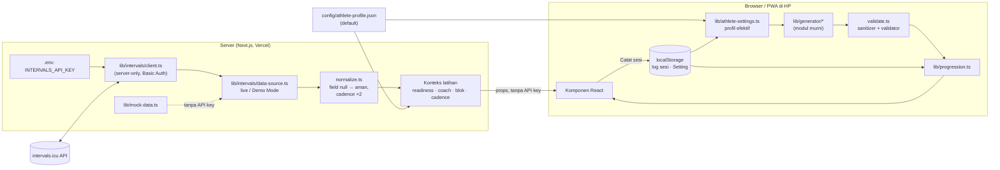

# Arsitektur

## Gambaran besar



## Prinsip desain

**1. API key tidak pernah sampai ke browser.** Semua panggilan intervals.icu ada di [`lib/intervals/client.ts`](../lib/intervals/client.ts), yang memakai `import "server-only"`, sehingga build akan gagal jika file ini diimpor dari komponen client. Halaman adalah Server Component yang mengambil data lalu mengirim hasil olahan (bukan key) sebagai props.

**2. Generator adalah fungsi murni.** `generateRunWorkout` dan `generateStrengthWorkout` menerima input + seed dan selalu mengembalikan hasil yang sama untuk input yang sama. Tidak ada I/O, tanggal, atau `Math.random()` di dalamnya. Semua konteks (blok periodisasi, cadence) masuk sebagai parameter. Karena itu generator bisa berjalan di browser (cepat, tanpa request) sekaligus diuji tuntas di Vitest.

**3. Pembuat pola ≠ penjaga aturan.** Pembuat pola (`run.ts`, `strength.ts`) bebas berkreasi. [`validate.ts`](../lib/generator/validate.ts) lalu:
- **menyanitasi**: membuang gerakan tidak terdaftar atau terlarang, meng-clamp RPE ≤ 7 dan beban ≤ batas library;
- **memvalidasi**: memeriksa prehab wajib, stabilitas panggul, urutan Upper Pull, dan toleransi durasi.

Pelanggaran akan melempar `WorkoutValidationError`. Hal yang sama berlaku untuk progresi beban: rekomendasi dari riwayat di-clamp lagi ke rentang library.

**4. Semua data eksternal dianggap bisa kosong.** Huawei Watch Fit 4 sering mengirim field null. [`normalize.ts`](../lib/intervals/normalize.ts) mengubah setiap field menjadi `number | undefined` yang aman, dan UI menampilkan `·`. Salinan Strava datang tanpa isi (intervals.icu tidak boleh meneruskannya lewat API) dan dibuang oleh [`dedupe.ts`](../lib/intervals/dedupe.ts) bila ada rekaman lain dari sesi yang sama. Aktivitas tanpa `id` dibuang.

**5. Zona waktu WIB.** Semua tanggal dihitung di UTC+7 ([`lib/date.ts`](../lib/date.ts)), dan minggu kalender dihitung Senin–Minggu.

**6. Sandi aplikasi berlapis (0.12.0).** `proxy.ts` mengunci halaman dan API, tetapi pengambilan data tidak bergantung padanya: `intervalsGet` memeriksa sesi lagi lewat `lib/auth/guard.ts`, sesuai anjuran Next.js agar proxy bukan satu-satunya pemeriksa. Sandi dan `SESSION_SECRET` hanya dibaca di server; browser hanya menerima status (`off` / `misconfigured` / `on`) untuk halaman `/unlock` dan boolean untuk kartu Keamanan.

## Modul

| Modul | Tanggung jawab | Berjalan di |
| --- | --- | --- |
| `lib/intervals/client.ts` | HTTP ke intervals.icu, Basic Auth, error terstruktur (401/403/404/5xx/timeout) | Server |
| `lib/intervals/data-source.ts` | Pilih data live atau Demo Mode, rakit `TrainingContext` | Server |
| `lib/intervals/normalize.ts` | Respons mentah → tipe aman | Server (dan mock) |
| `lib/intervals/dedupe.ts` | Buang rekaman ganda sesi yang sama (mis. Huawei + salinan Strava kosong), simpan yang paling lengkap | Server (dan mock) |
| `lib/intervals/splits.ts` | Split per km dari stream time/distance/HR/cadence. `buildTrack` membersihkan jarak (hanya naik, tolak lonjakan > 12 m/s & reset) dan meratakan jarak bertangga; status bergerak dari kecepatan antar titik-ubah (ambang lari 30:00/mil seperti Strava). Batas km diinterpolasi, sisa < 50 m digabung. Jarak yang hanya dibagi rata diganti GPS (`latlng`). Hasil divalidasi terhadap ringkasan aktivitas | Server (dan mock) |
| `lib/intervals/summary.ts` | Ringkasan 7 hari, rata-rata cadence | Server |
| `lib/readiness.ts` | Sinyal HRV / resting HR / sesi kemarin | Server |
| `lib/coach.ts` | Saran 80/20, progresi km, concurrent, + `suggestFor()` | Server & client |
| `lib/generator/block.ts` | Posisi blok & deload dari tanggal | Server |
| `lib/generator/run.ts`, `strength.ts` | Pembuat pola | Client |
| `lib/generator/validate.ts` | Sanitizer + validator | Client |
| `lib/generator/variation.ts` | Deteksi variasi & seed berikutnya yang pasti berbeda | Client |
| `lib/generator/format.ts` | Teks salin & format Set Huawei | Client |
| `lib/progression.ts` | Aturan 2-for-2, penerapan ke workout | Client |
| `lib/training-log.ts` | Penyimpanan log (localStorage) + ekspor/impor | Client |
| `lib/conditions.ts` | Katalog kondisi berbasis riset → aturan generator | Server & client |
| `lib/run-zones.ts` | Rumus VDOT Daniels, parser & format pace | Client |
| `lib/equipment.ts` | Kebutuhan alat per gerakan, beban yang bisa dirakit dari plat | Server & client |
| `lib/athlete-settings.ts` | Pengaturan Setting (termasuk profil dasar sejak 0.11) + `resolveProfile()` → profil efektif (JSON netral + pengaturan perangkat), format target lomba, gerakan cadangan (`fallback`) aktif otomatis bila kategorinya kosong, `sessionCoverage()` untuk pesan alat di Strength | Server & client |
| `lib/settings-store.ts` | Hook `useAthleteSettings` / `useResolvedProfile`, `useBlockMode` / `useBlockContext` (blok dihitung dari profil perangkat), `useIsClient` | Client |
| `lib/onboarding.ts` | State machine onboarding murni: langkah, syarat lanjut, lewati, lanjut dari langkah tersimpan, pengguna lama (`migrated`), versi disclaimer, `gateDecision`, langkah pasang otomatis selesai saat standalone, `confirmProtection`, `pendingReminders`, `completeTour` | Server & client |
| `lib/tour.ts` | Langkah tur in-app (rute + target `data-tour`), `placePopover` (bawah → atas → sisi lebih lega, dijepit ke viewport & safe area), `holeRect` | Server & client (murni) |
| `lib/onboarding-store.ts` | Hook status onboarding + deteksi data sebelum 0.11 | Client |
| `lib/backup.ts` | Format cadangan v3 murni (`buildBackup`, `parseBackup`, `applyBackup`); v1/v2 tetap diterima | Server & client |
| `lib/backup-store.ts` | `BackupStore` di atas localStorage, ekspor/impor file | Client |
| `components/onboarding/*` | `OnboardingGate` (di layout), `OnboardingWizard` (`/onboarding`, memakai ulang komponen Setting), `TermsStep`, `ConnectionStep`, `ProtectStep`, `InstallStep` (juga dipakai `components/settings/PendingCard.tsx`), `Tour` (`TourProvider` di layout: spotlight, pindah tab, `useTour().start` dari ringkasan onboarding & Setting) | Client |
| `lib/intervals/connection.ts` | Pemetaan hasil `GET /athlete/{id}` → status koneksi (`ok`, `missing`, `unauthorized`, `forbidden`, `not_found`, `network`) + nama atlet saja | Server & client (murni) |
| `proxy.ts` | Kunci sandi aplikasi (Next.js 16: middleware = proxy, runtime Node.js). Tanpa `APP_PASSCODE` meneruskan semua; selain itu halaman → `/unlock?next`, API → 401. Matcher mengecualikan `_next/static`, manifest, ikon | Server (proxy) |
| `lib/auth/config.ts` | `passcodeConfig(env)`: `off` / `misconfigured` (sandi < 8 karakter atau secret < 32 byte, gagal tertutup) / `on` | Server (murni) |
| `lib/auth/session.ts` | Cookie `ha_session` = `v1.<exp>.<HMAC>`; tanda tangan menyertakan sidik jari sandi; `checkPasscode` & verifikasi memakai `timingSafeEqual` | Server |
| `lib/auth/access.ts` | Keputusan proxy murni (`decide`), daftar path publik, `sanitizeNext` (hanya path di situs ini) | Server (murni) |
| `lib/auth/rate-limit.ts` | 5 gagal / 15 menit per IP (hash). Upstash REST lewat `fetch` bila `KV_REST_API_*` / `UPSTASH_REDIS_REST_*` ada, jatuh ke memori bila gagal | Server |
| `lib/auth/unlock.ts`, `app/api/unlock/route.ts`, `app/api/lock/route.ts` | POST unlock (204 + cookie, 401 sisa percobaan, 429 Retry-After, 503 konfigurasi tidak lengkap) dan lock (hapus cookie) | Server |
| `lib/auth/guard.ts` | `isRequestUnlocked()` dipanggil di awal `intervalsGet`: request tanpa sesi tidak pernah memicu panggilan intervals.icu (error `LOCKED`) | Server |
| `app/api/connection/route.ts` | `GET /api/connection` untuk onboarding langkah 3 & pengingat: `{ status, athleteName? }`, `force-dynamic`, `Cache-Control: no-store` | Server |
| `lib/install-prompt.ts` | Tangkap `beforeinstallprompt` / `appinstalled` sejak awal, deteksi standalone & platform (`useInstallState`) | Client |
| `scripts/make-owner-settings.mjs` | Sekali jalan: profil di JSON lama → `owner-settings.local.json` (cadangan v3 `kind: "defaults"`, tanpa log) | Node |
| `lib/movements/media.ts` | Gambar (path lokal), sumber & lisensi, cue, otot, catatan kondisi per gerakan | Server & client (juga dibaca script Node) |
| `scripts/audit-movement-media.mjs` | Audit pencocokan library ↔ free-exercise-db; gagal bila ada gerakan belum diaudit | Dev |
| `scripts/fetch-movement-media.mjs` | Unduh gambar yang dipakai → WebP ≤ 600 px di `public/movements/` | Dev |

## Penyimpanan

> **Catatan keputusan (2026-10-23), berlaku mulai 0.12.** Prinsip "data kesehatan tidak keluar dari HP" di bawah akan berubah. Sejak 0.12 data (log, Setting, program, profil, status onboarding) boleh disinkronkan ke **database milik pengguna sendiri** (Upstash Redis di akun Vercel-nya), **hanya bila** pengguna memasang database dan sandi aplikasi. Database diakses lewat server saja; tanpa database, aplikasi tetap lokal seperti sekarang. Tidak ada database bersama, dan enkripsi sisi klien belum termasuk 0.12. Diagram, tabel modul, dan tabel di bawah diperbarui saat rilis. Spesifikasi: [SYNC.md](SYNC.md).

| Data | Tempat | Alasan |
| --- | --- | --- |
| Profil default | `config/athlete-profile.json` di repo, **netral** sejak 0.11 (tanpa nama, kondisi, alat; zona dari VDOT 30) | Fork baru tidak mewarisi data siapa pun. Movement library tetap di sini |
| Data latihan & wellness | intervals.icu (dibaca, tidak disimpan) | Satu sumber kebenaran |
| Log sesi ST | `localStorage` perangkat | Tanpa setup/biaya. Data kesehatan tidak keluar dari HP. Cadangan lewat ekspor JSON |
| Setting (profil dasar, kondisi, zona, alat, gerakan), program target, tema, mode blok, status onboarding | `localStorage` perangkat | JSON netral jadi default; pengaturan perangkat menimpa. Ikut ekspor/impor JSON (format v3) |

Key `localStorage` (pola `hybrid-athlete.<nama>[.vN]`, di `lib/preference-keys.ts`):

| Key | Isi |
| --- | --- |
| `hybrid-athlete.settings.v1` | `AthleteSettings`: `profile` (override per field), `conditions` & `equipment` (nilai penuh begitu disimpan), `runZones` & `movements` (override) |
| `hybrid-athlete.log.v1` | Log sesi ST |
| `hybrid-athlete.program` | Program target |
| `hybrid-athlete.theme` | `light` / `dark` (kosong = sistem) |
| `hybrid-athlete.block-enabled` | `1` / `0`; kosong = aktif hanya bila profil punya tanggal mulai blok |
| `hybrid-athlete.onboarding.v1` | `OnboardingState` |

**Format cadangan v3** (`lib/backup.ts`): `{ app, version: 3, kind, exportedAt, log, settings, program, preferences, onboarding }`. `kind: "backup"` menimpa bagian yang ada di file; `kind: "defaults"` (file migrasi) hanya mengisi yang masih kosong di perangkat. Log selalu digabung tanpa duplikat; file tanpa log tidak menyentuh log.

**Gate onboarding** (`components/onboarding/OnboardingGate.tsx`, di dalam `<main>` layout): status hanya ada di perangkat, jadi diperiksa di client. Sebelum localStorage terbaca tampil kerangka. Pengguna baru → `/onboarding` (tanpa BottomNav); pengguna lama (punya Setting/log/program) → `migrated` + disclaimer saja sekali; `termsVersion` < `TERMS_VERSION` → disclaimer saja. Header Profil, target, dan posisi blok kini dibaca di client dari profil perangkat, bukan dari JSON di server.

Keterbatasannya, log dan Setting hanya ada di satu perangkat. Jalur upgrade-nya adalah database (misalnya Upstash Redis lewat Vercel) dengan proteksi PIN/secret, karena aplikasi belum punya login.

## Design system

Sumber kebenaran desain: **[DESIGN-SYSTEM.md](DESIGN-SYSTEM.md)** (design system "Tag", 0.10.0-ui). Ringkasnya:

- Semua warna lewat **token semantik** di [`app/globals.css`](../app/globals.css) (`bg-surface`, `text-muted`, `bg-brand`, `fill-track`, …). Tema gelap (wajah utama) dipasang lewat `<html data-theme="dark">` atau mengikuti sistem; script di `<head>` memasangnya sebelum render. Komponen tidak memakai class `dark:`, cukup nilai token yang berganti.
- Satu aksen oranye `#FC4C02` untuk chrome; hijau/kuning/merah hanya warna data (`components/ui/tones.ts`). Teks oranye selalu `brand-ink`. **Rencana = warna intensitas, selesai = oranye.**
- Tipografi: Archivo (variable, sumbu `wdth`) + Geist Mono lewat `next/font/google`; utility `.t-display`, `.t-stat`, `.t-ledger`, `.t-label`.
- Komponen dasar di `components/ui/`: `Card` (`tone="tag"`, `kicker`), `StatRow`, `BUTTON` (primary/secondary/ghost/inverse), `Chip`, `Segmented`, `Switch`, `TimePicker` (pemilih jam/menit/detik tanpa mengetik). Grafik: `components/charts/SegmentSkyline.tsx` (logika murni di `skyline-scale.ts`, diuji).
- Motion: `--ease-out` / `--ease-in-out` / `--ease-drawer`, tekan 140ms, hover hanya `(hover: hover) and (pointer: fine)` (varian Tailwind `hover` didefinisikan ulang), reduced motion dihormati.

## Testing

```bash
npm test
```

Test aturan (generator, periodization, media, settings) memakai profil contoh anonim `__tests__/fixtures/example-athlete.json` lewat `vi.mock` pada JSON profil, karena JSON di repo netral.

| File | Cakupan |
| --- | --- |
| `generator.test.ts` | Seluruh kombinasi input (9 lari + 36 ST) × 25 seed × 3 kondisi blok. Durasi ±2 menit, RPE ≤ 7, beban ≤ library, prehab wajib, whitelist gerakan, Spine-Friendly, dan sanitizer. |
| `periodization.test.ts` | Posisi blok & deload, gerakan ★ tetap per blok dan selalu multi-joint, rotasi skema rep, jumlah pola lari, target cadence. |
| `coach.test.ts` | Klasifikasi lari berat / ST kaki, 80/20, progresi km, concurrent, dan penggabungan saran tanpa penurunan berantai. |
| `progression.test.ts` | Aturan 2-for-2, tahan/turun, batas library, deload, gerakan tahan & band, validasi data impor. |
| `data.test.ts` | Tanggal WIB, normalisasi field null & cadence, ringkasan 7 hari, readiness. |
| `activity-data.test.ts` | Dedupe Huawei + salinan Strava (urutan apa pun, tanpa pasangan, beda jenis, dua rekaman berisi), split per km (konstan, berhenti, HR berbobot, data rusak, cadence per-kaki), sumber jarak (dibagi rata, GPS, tanpa GPS), kasus tepi data jam (jarak bertangga, berhenti, lonjakan, reset, GPS hilang, validasi ringkasan, ambang lari/jalan), detail demo. |
| `program.test.ts` | Program target: fase, long run ≤ 10%/2 km, cutback, taper, peringatan. |
| `media.test.ts` | Setiap gerakan punya entri media, setiap path gambar ada, sumber/lisensi konsisten, gerakan baru bisa dijangkau & lolos semua aturan, titik tambat band, ★ baru mulai blok berikutnya. |
| `skyline-scale.test.ts` | Skala tinggi Segment Skyline (min 10%, steady dari nol), deteksi segmen kerja (WORK / median, lap otomatis), tata letak bar, aturan label, stagger, ringkasan struktur & best rep. |
| `auth.test.ts` | Konfigurasi sandi (off/misconfigured/on), sesi (90 hari, kedaluwarsa, dipalsukan, ganti sandi/secret membatalkan, cookie tanpa sandi), `timingSafeEqual` dipakai, batas percobaan (memori dengan jam tiruan, Redis REST palsu, fallback), logika unlock (6 salah → 429, respons tanpa sandi), keputusan proxy & `sanitizeNext`. |
| `auth-routes.test.ts` | Route `/api/unlock` & `/api/lock` end-to-end (atribut cookie, Retry-After, IP lain tidak terblokir), `proxy` dengan `NextRequest` (tanpa sandi identik 0.11, 307/401, aset PWA terbuka, matcher), dan `intervalsGet` tidak memanggil intervals.icu tanpa sesi. |
| `connection.test.ts` | Pemetaan status koneksi (missing tanpa panggilan, 401/403/404/5xx/timeout/jaringan/lainnya), hanya nama atlet yang diteruskan, dan route `GET /api/connection` end-to-end dengan `fetch` palsu: respons tanpa key, athlete ID, atau email; header `no-store`; key hanya di header Authorization. |
| `onboarding.test.ts` | Urutan & langkah otomatis 0.11.0, maju/mundur, langkah wajib memblokir, opsional dilewati, lanjut dari langkah tersimpan, state rusak, "Tidak ada kondisi" eksklusif, gate (baru/lama/versi disclaimer). |
| `backup.test.ts` | Ekspor v3, impor v1/v2/v3, impor tanpa log tidak menghapus log, log tanpa duplikat, `kind: "defaults"` tidak menimpa kustomisasi perangkat. |
| `neutral-profile.test.ts` | JSON netral tanpa data pribadi, zona = `zonesFromVdot(30)`, semua kombinasi lari valid dengan profil netral, ST bodyweight-only: semua jenis × durasi × kesulitan × 25 seed × blok/deload/bebas tidak error, lolos aturan wajib, dan Upper Push/Pull berisi gerakan kategorinya. |
| `tour.test.ts` | Urutan & rute langkah tur, teks tanpa dash/seru, `placePopover` (bawah, atas, elemen setinggi layar, tanpa elemen, layar lebar), `holeRect`, `tourCompletedAt` tersimpan. |
| `tour-targets.test.ts` | Setiap target `data-tour` benar-benar dipasang di komponen. |
| `settings.test.ts` | Setiap kondisi mengubah generator sesuai aturannya, kombinasi semua kondisi tetap valid, beban selalu bisa dirakit dari alat, gerakan tidak dipilih tidak pernah muncul, rumus VDOT vs tabel Daniels, parser pengaturan tahan data rusak. |

Generator diuji secara menyeluruh (setiap kombinasi × banyak seed), bukan hanya dengan beberapa contoh. Bug yang ditemukan saat pengembangan, seperti deload yang gagal memenuhi durasi atau beban yang terbulatkan salah, selalu disertai test baru.
